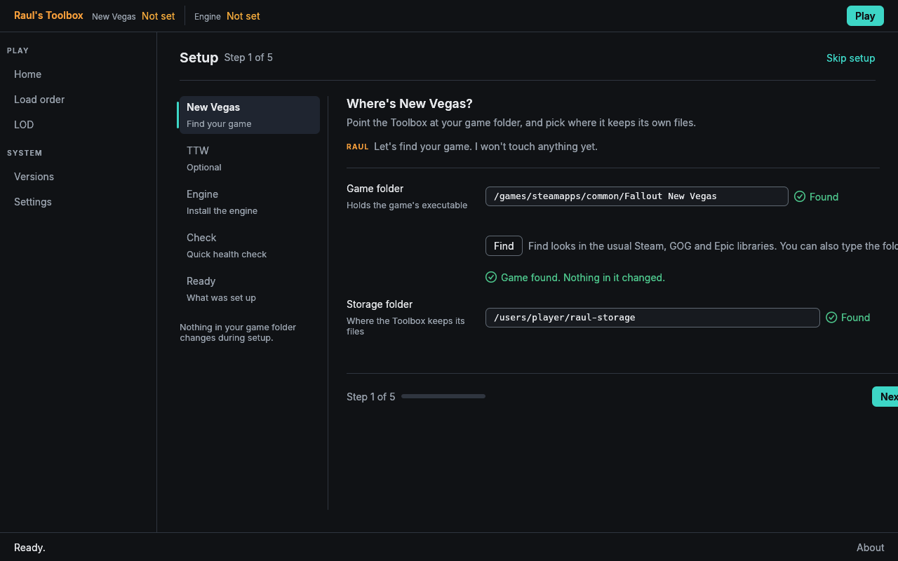
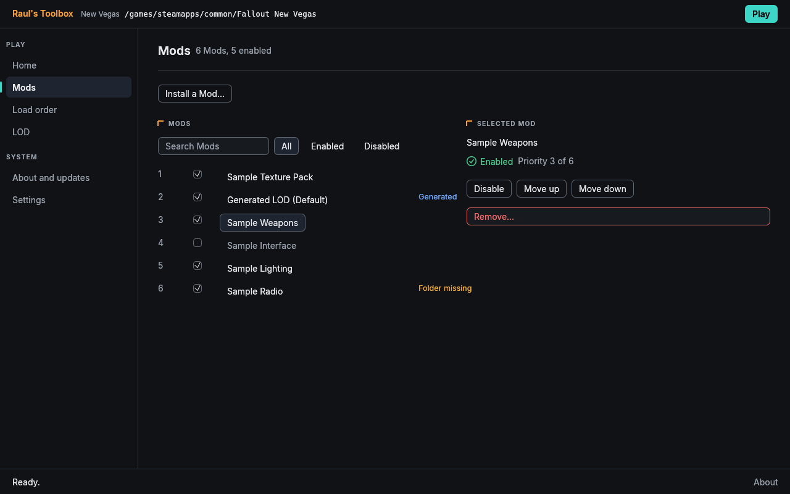
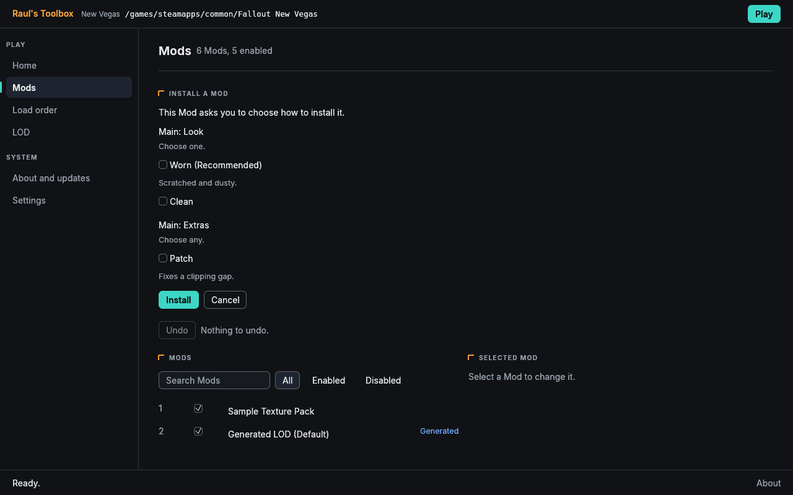
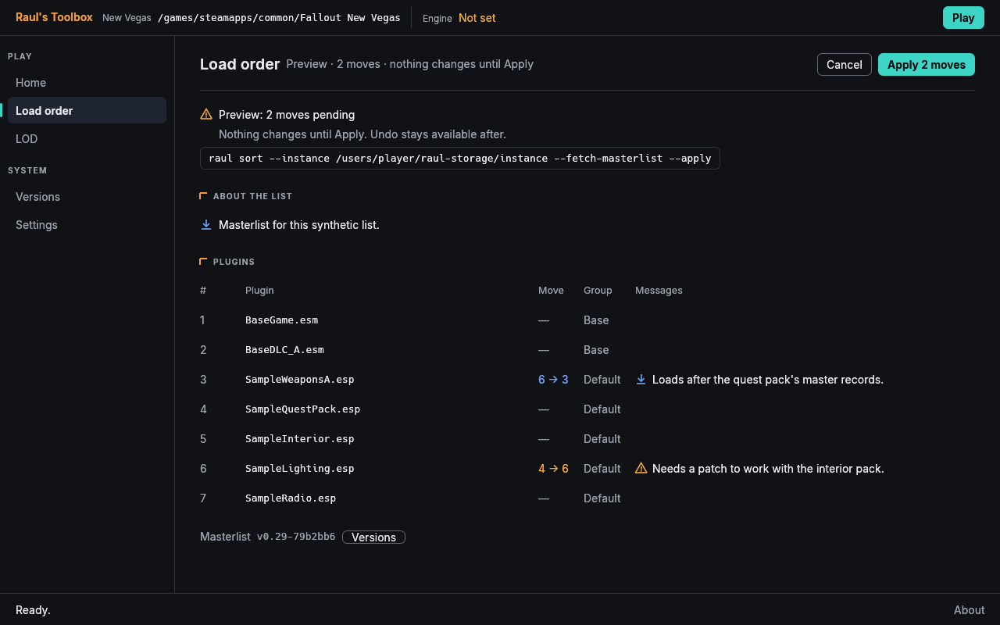
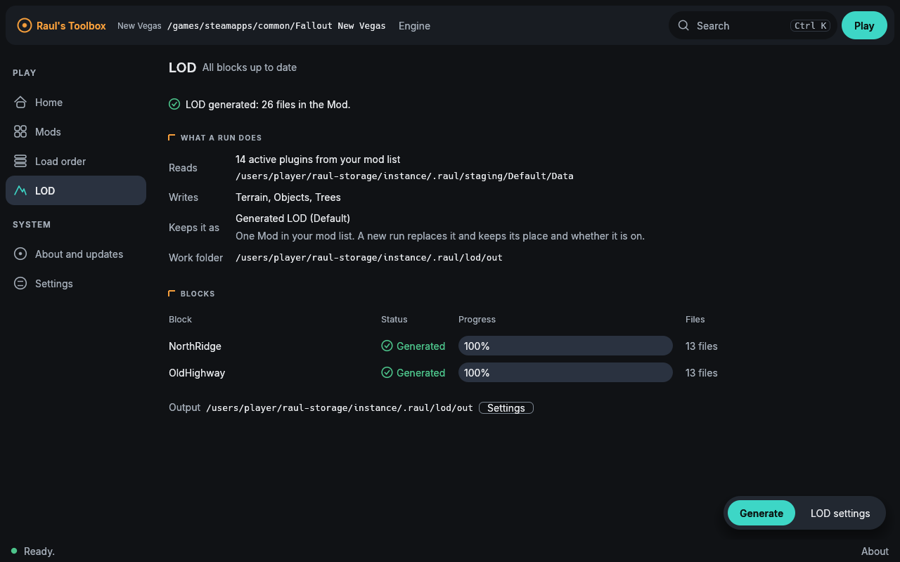
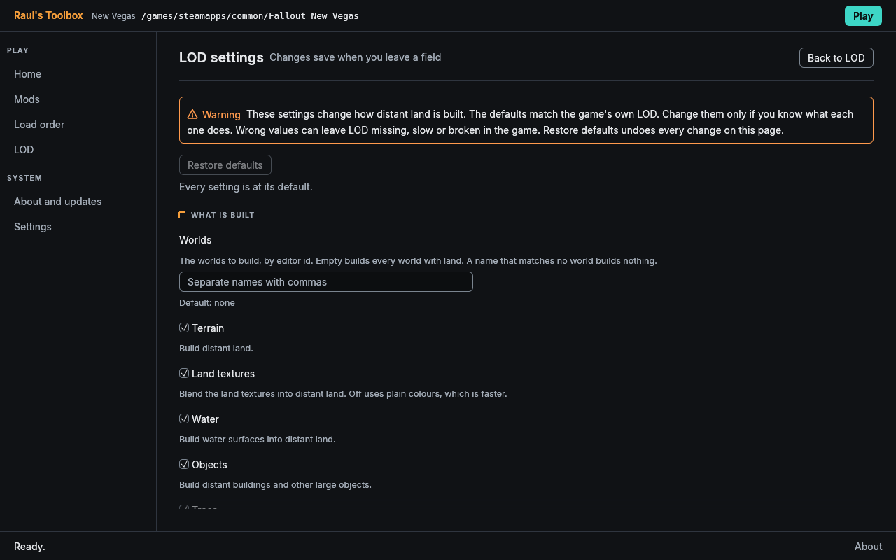
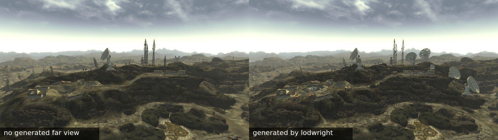
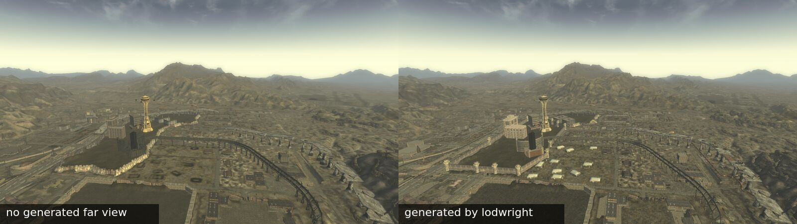
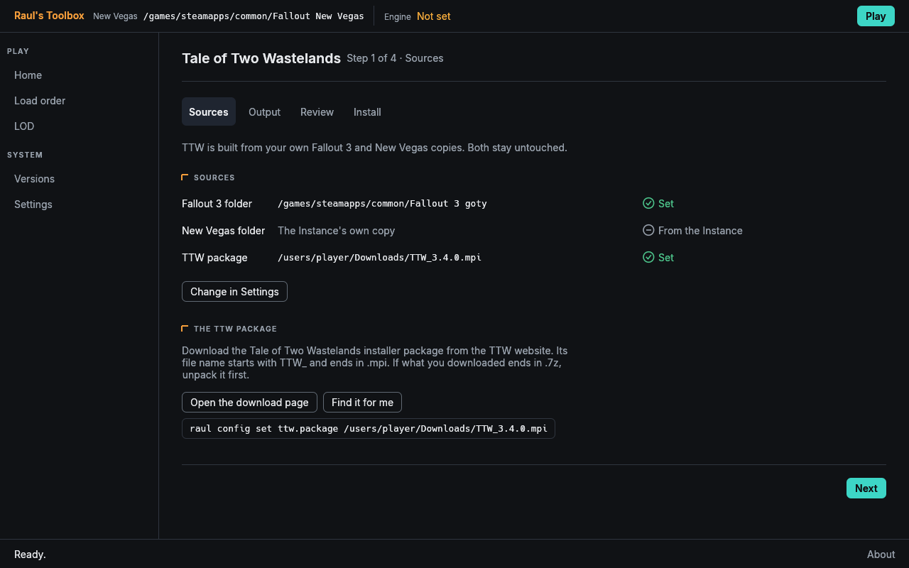
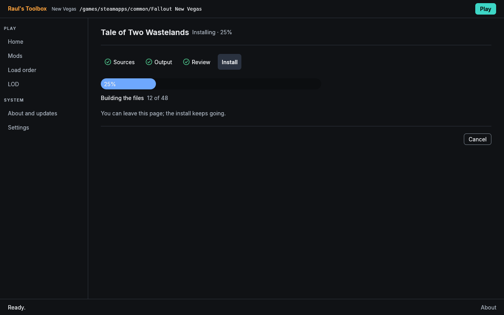

# Raul's tRusty Toolbox

> *Modding New Vegas without the fRUSTration.*

Raul's tRusty Toolbox (`raul`) is one program for Fallout: New Vegas on Linux, Windows and macOS. It finds your game,
sets up Tale of Two Wastelands if you want it, installs and sorts your mods, builds the distant land (LOD) for your
load order, and starts the game on [nv-rs](https://github.com/JorisJonkers-dev/nv-rs), a Rust rebuild of the game's
engine. Everything happens in one window, and the same steps are commands on the command line. Your game folder is
never changed: raul keeps its own copy of what it needs.

**[Download the latest release](https://github.com/JorisJonkers-dev/rauls-trusty-toolbox/releases/latest)** (see
[Install](#install) for which file to take and how to check it).

<p align="center">
  
</p>

**Status: early releases (0.x).** The setup wizard, Tale of Two Wastelands, Mods, Load order, LOD and Play work on
Linux, Windows and macOS. The installers are built and smoke-tested for all three systems; Windows and macOS have not
yet had a full run on real hardware, their packages are unsigned, and the icon is a placeholder. The plan is in
[`docs/PLAN.md`](docs/PLAN.md) and [`docs/REORG.md`](docs/REORG.md), the design in
[`docs/ARCHITECTURE.md`](docs/ARCHITECTURE.md), decisions in [`docs/adr`](docs/adr) and terms in
[`GLOSSARY.md`](GLOSSARY.md).

**Known issue in v0.6.0:** the distant land that raul generated had no far water; lakes and rivers such as Lake Mead
and the Colorado were not drawn at a distance. The generator that raul builds in now draws them (lodwright 0.15.1). If
you made LOD with v0.6.0, install a newer release and generate the LOD again.

## A tour

The pictures below are raul's own pages, rendered by its test suite from made-up example data
(`crates/raul-gui/tests/snapshots`), so they always show the current window.

### Setup

The first start walks through five steps: find New Vegas (Steam, GOG and Epic libraries are searched), choose whether
you want Tale of Two Wastelands, make the Instance (raul's own folder for the game's mods, profiles and downloads), run a quick check, done.

<p align="center"></p>

### Mods

Install a mod from its archive; a mod with an installer (FOMOD) asks its questions in the window. Mods can be turned
on and off, moved up and down, and removed, and every change can be undone. This page is
[nvmod-rs](https://github.com/JorisJonkers-dev/nvmod-rs) at work.

<p align="center">
  
  
</p>

### Load order

Sort the plugins with the LOOT masterlist. raul shows every move and the masterlist's messages first, and changes
nothing until you press Apply. Sorting is [loot-rs](https://github.com/JorisJonkers-dev/loot-rs).

<p align="center"></p>

### LOD

Generate the distant land, objects and trees for exactly your load order. The result is one Mod in your mod list,
`Generated LOD (<profile>)`; a new run replaces it. The settings page changes what is built. The generator is
[lodwright-rs](https://github.com/JorisJonkers-dev/lodwright-rs).

<p align="center">
  
  
</p>

Why it matters: with mods, the game's own far view no longer matches the world you walk through. On a 312-mod Tale
of Two Wastelands profile, a far view generated for that load order brings back the dishes on Black Mountain and the
casinos and buildings of the Strip (right):

<p align="center">
  
  
</p>

### Tale of Two Wastelands

TTW is built from your own Fallout 3 and New Vegas copies and the installer package you download from the TTW site;
both games stay untouched. raul checks the sources, shows where the output goes and how much space it needs, installs,
and adds TTW to the Instance as one Mod. The installer is [ttwright-rs](https://github.com/JorisJonkers-dev/ttwright-rs).

<p align="center">
  
  
</p>

### Play

**Play** starts the game on the nv-rs engine, which is built into raul. The engine's graphics presets and its F10
overlay are described in the [nv-rs README](https://github.com/JorisJonkers-dev/nv-rs#readme). Settings holds the game
folders, the TTW package and raul's storage folder; About and updates checks for a new release only when you ask, and
an update keeps the version before it so you can go back.

## Install

Download the package for your system from the
[latest release](https://github.com/JorisJonkers-dev/rauls-trusty-toolbox/releases/latest) and check it against
`SHA256SUMS`: `sha256sum -c SHA256SUMS --ignore-missing` in the download folder (Linux), or compare
`shasum -a 256 <file>` (macOS) or `Get-FileHash <file>` (Windows PowerShell) with the matching line of that file.
That needs nothing else installed.

To also check where the file was built, use `gh attestation verify <file> --repo JorisJonkers-dev/rauls-trusty-toolbox`.
It needs GitHub CLI 2.49 or newer (the `gh` package of many distributions is older and has no `attestation` command) and
a GitHub login (`gh auth login`), because GitHub asks for one even for a public repository.

| System | Package | Notes |
| --- | --- | --- |
| Linux (x64, glibc 2.35+, Steam Deck) | `.AppImage`, `.deb` or `.tar.gz` | `chmod +x` the AppImage and run it; or `sudo apt install ./raul-*.deb` (package `raul`, its libraries come with it) |
| Windows 10 22H2 / 11 (x64) | `-setup.exe` or `-portable.zip` | installs for your user only; unsigned for now, so SmartScreen may warn |
| macOS 13+ (Apple silicon and Intel) | `.dmg` | unsigned until signing is set up: allow it under System Settings, Privacy & Security |

The `.deb` pulls in the libraries the window needs. The AppImage and the `.tar.gz` do not carry them: on a plain
Debian or Ubuntu install `libx11-6 libx11-xcb1 libxcb1 libxcursor1 libxi6 libxrandr2 libxrender1 libxkbcommon0
libxkbcommon-x11-0 libwayland-client0 libwayland-egl1 libegl1 libgl1 libvulkan1 libpulse0 mesa-vulkan-drivers` first
(other distributions: the same libraries under their own names). To play, the engine's shader compiler `libvkd3d-shader1`
is also needed where your distribution has it.

### From source

```sh
git clone --recursive https://github.com/JorisJonkers-dev/rauls-trusty-toolbox.git
cd rauls-trusty-toolbox
cargo run -p raul-cli -- --version
```

The toolchain (Rust 1.100.0) comes from `rust-toolchain.toml`. Building the bundled ttwright-rs needs `make`, a C
compiler and `pkg-config`.

## Command line

Every page has a command, so raul also works in a terminal or a script:

```sh
raul detect                                   # find your game copies
raul init --base "<game folder>" --instance ~/raul/fnv
raul profile create --instance ~/raul/fnv
raul install <mod archive> --instance ~/raul/fnv
raul sort --instance ~/raul/fnv --fetch-masterlist --apply
raul ttw --instance ~/raul/fnv                 # Tale of Two Wastelands, if you want it
raul target nv-rs --instance ~/raul/fnv        # run on the engine built into raul; nothing to install
raul lod generate --instance ~/raul/fnv
raul run nv-rs --instance ~/raul/fnv
```

`raul help` lists the Toolbox's own commands, `raul nvmod-help` every nvmod command; add `--json` for scripts.

## Components

raul is made of five Components, each in its own repository with its own history, issues, releases and CI:

| Component | What it does |
| --- | --- |
| [nv-rs](https://github.com/JorisJonkers-dev/nv-rs) | The engine (this organisation's fork of [slaterain/nv-rs](https://github.com/slaterain/nv-rs)) |
| [nvmod-rs](https://github.com/JorisJonkers-dev/nvmod-rs) | Mod management: instances, profiles, mod installs, staging, conflicts, load order, content Doctor |
| [loot-rs](https://github.com/JorisJonkers-dev/loot-rs) | Load-order sorting against the LOOT masterlist |
| [lodwright-rs](https://github.com/JorisJonkers-dev/lodwright-rs) | Distant terrain, object and tree LOD generation |
| [ttwright-rs](https://github.com/JorisJonkers-dev/ttwright-rs) | Tale of Two Wastelands installation from the player's own game copies |

**Why they are separate.** Each Component does one job, works and is tested on its own (each has its own command
line), and releases when it is ready. raul links them all into one program and calls them in its own process; only the
game itself runs as a separate process, started from raul's own binary. A raul release pins one set of Component
versions that were tested together ([ADR-0001](docs/adr/0001-the-toolbox-is-the-product-umbrella.md),
[ADR-0016](docs/adr/0016-components-are-incorporated-libraries-called-in-process.md),
[ADR-0019](docs/adr/0019-raul-orchestrates-nvmod-manages-mods.md)).

## Origins

The engine is [nv-rs](https://github.com/slaterain/nv-rs) by slaterain, the Rust port of Fallout: New Vegas; raul uses
the JorisJonkers-dev fork of it, which replays upstream's work regularly and keeps its licence, attribution and legal
notice. Load-order sorting follows the rules and masterlist of the [LOOT](https://loot.github.io/) project, which
loot-rs reads at run time and does not redistribute. ttwright-rs is a rewrite of
[SulfurNitride/TTW_Linux_Installer](https://github.com/SulfurNitride/TTW_Linux_Installer).

## Legal

You need your own, legally obtained copy of Fallout: New Vegas (and of Fallout 3 for Tale of Two
Wastelands). This project ships and downloads no game files and no game assets. It is an
independent project, not affiliated with or endorsed by Bethesda Softworks, ZeniMax Media or
Obsidian Entertainment; Fallout and related names are trademarks of their respective owners.
The pictures of the game in `docs/images` are screenshots taken with the engine for this README.

## Licence

GPL-3.0-only (see [`LICENSE`](LICENSE)), because `raul` links nvmod-rs and loot-rs, which are
GPL-3.0-only ([ADR-0002](docs/adr/0002-raul-links-nvmod-and-loot-rs-and-runs-the-rest-as-processes.md)).
