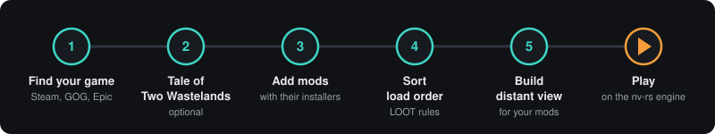

# Raul's tRusty Toolbox

> *Modding New Vegas without the fRUSTration.*

Raul's tRusty Toolbox, or **raul**, is one app that sets up Fallout: New Vegas with your mods and starts the game.
It works on Linux, Windows and macOS, and it never changes your game folder.

  

## From game to playing, in six steps

  

raul does each step for you in one window. Skip what you do not need; Tale of Two Wastelands is optional.

## A distant view that matches your mods

Mods change the world, but the game's own far view stays the old one. raul builds a new far view for exactly your mods.

  
   <em>Large far objects stay in view: the I-15 overpasses north of Freeside no longer vanish at mid distance.</em>

  
   <em>The Strip with 312 mods: the game's far view (left) and the one raul built (right).</em>

## How far along it is

- ✅ Setup, mods, load order, distant view, Tale of Two Wastelands and Play work on all three systems.
- 🔨 Early releases (0.x): Windows and macOS still need a full test on real computers, and the downloads are not
  signed yet.

The game engine inside raul, counted from its code after every change:

  

## How it fits together

  

Splitting the work this way lets each part be tested on its own. [More about the parts](docs/COMPONENTS.md).

## Install

**[Download raul](https://github.com/JorisJonkers-dev/rauls-trusty-toolbox/releases/latest)**: take the file for
your system (Linux `.AppImage` or `.deb`, Windows `-setup.exe`, macOS `.dmg`). Which file to pick, how to check it and
how to build raul yourself: [docs/INSTALL.md](docs/INSTALL.md).

You need your own copy of Fallout: New Vegas (and of Fallout 3 for Tale of Two Wastelands).

## Learn more

- [A tour of the window, page by page](docs/TOUR.md)
- [Using raul from the command line](docs/USAGE.md)
- [The parts and where they come from](docs/COMPONENTS.md)
- [How it is built](docs/ARCHITECTURE.md) and [the plan](docs/PLAN.md)

raul ships no game files and is not affiliated with Bethesda Softworks, ZeniMax Media or Obsidian Entertainment.
The game pictures in `docs/images` are screenshots taken with the engine for this page. Licence: GPL-3.0-only
([LICENSE](LICENSE), [legal notes](docs/INSTALL.md#legal)).
