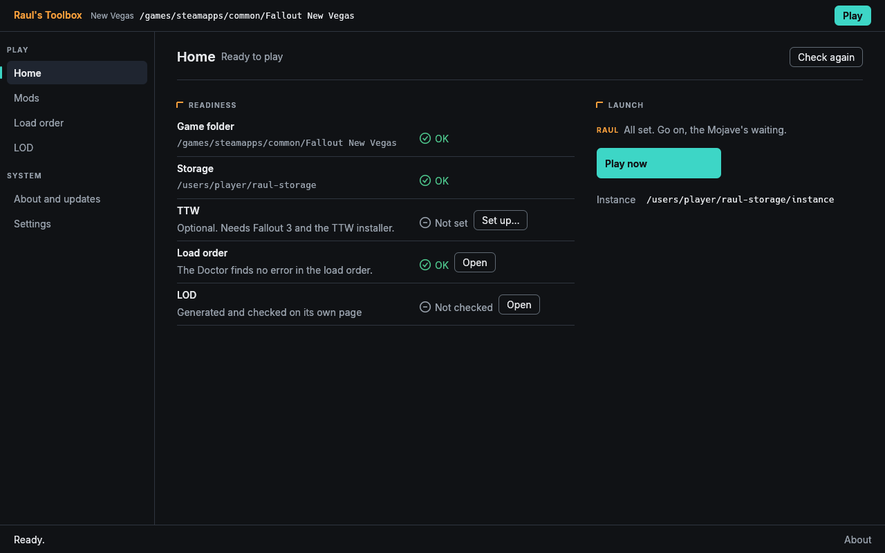
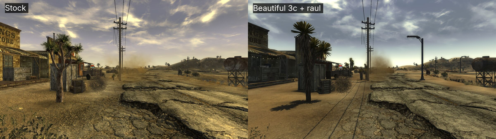
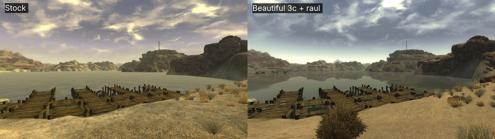
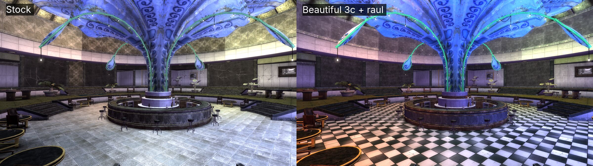
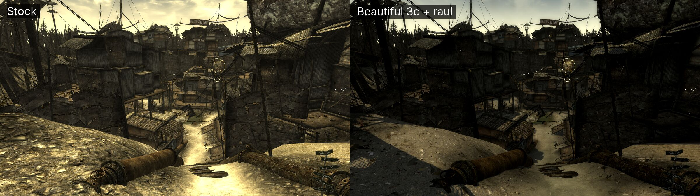
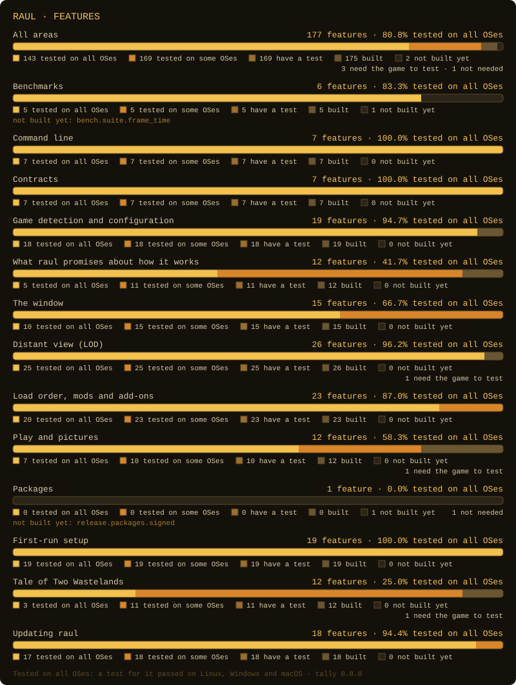

# Raul's tRusty Toolbox

> *Modding New Vegas without the fRUSTration.*

Raul's tRusty Toolbox, or **raul**, is one app that sets up Fallout: New Vegas with your mods and starts the game.
It works on Linux, Windows and macOS, and it never changes your game folder.

  

## From game to playing, in six steps

  

raul does each step for you in one window. Tale of Two Wastelands, a mod that joins Fallout 3 and New Vegas into one
game, is optional.

## A distant view that matches your mods

Mods change the world, but the game's own far view stays the old one. raul builds a new far view for exactly your mods.

  
   <em>Large far objects stay in view: the I-15 overpasses north of Freeside no longer vanish at mid distance.</em>

  
   <em>The Strip with 312 mods: the game's far view (left) and the one raul built (right).</em>

## The Beautiful mod list

Left is the stock game: no mods, the game's own renderer. Right is the Beautiful 3c mod list with raul's engine
features (ambient occlusion, sun shadows, reflections, fill light) and a generated far view.

  
   <em>Goodsprings main street: new ground and building textures, a street lamp, sun shadows.</em>

  
   <em>Lake Mead from the shore: water reflections, sharper rocks and sand.</em>

  
   <em>Ultra-Luxe lobby: retextured floor, ambient occlusion, coloured light.</em>

  
   <em>Megaton (Tale of Two Wastelands): shadows and bulbs.</em>

There are thirteen views in all, in the Mojave and the Capital Wasteland, outside and inside. [Slide between them on the site](https://jorisjonkers-dev.github.io/rauls-trusty-toolbox/compare/).

## How far along it is

- ✅ Setup, mods, load order, distant view, Tale of Two Wastelands and Play work on Linux, Windows and macOS.
- 🔨 These are early versions. Windows and macOS still need a full test on real computers, and your computer may
  warn that the download comes from an unknown maker, because it is not signed yet.

How much of the game engine inside raul is rebuilt; the chart updates itself with every change to the engine:

  

How much of what raul promises is tested, per area; the chart updates itself with every change
([how it works](docs/COVERAGE.md#feature-catalogue)):

  

## How it fits together

  

Splitting the work this way lets each part be tested on its own. [More about the parts](docs/COMPONENTS.md).

## Install

**[Download raul](https://github.com/JorisJonkers-dev/rauls-trusty-toolbox/releases/latest)** and pick the file for
your computer: Linux, Windows or macOS. The [install guide](docs/INSTALL.md) names the exact file, shows how to check
the download, and how to build raul yourself.

You need your own copy of Fallout: New Vegas (and of Fallout 3 for Tale of Two Wastelands).

## Learn more

- [A tour of the window, page by page](docs/TOUR.md)
- [Using raul from the command line](docs/USAGE.md)
- [The parts and where they come from](docs/COMPONENTS.md)
- [How it is built](docs/ARCHITECTURE.md) and [the plan](docs/PLAN.md)

raul ships no game files and is not affiliated with Bethesda Softworks, ZeniMax Media or Obsidian Entertainment.
The game pictures in `docs/images` are screenshots taken with the engine for this page. Licence: GPL-3.0-only, a free licence
([LICENSE](LICENSE), [legal notes](docs/INSTALL.md#legal)).
