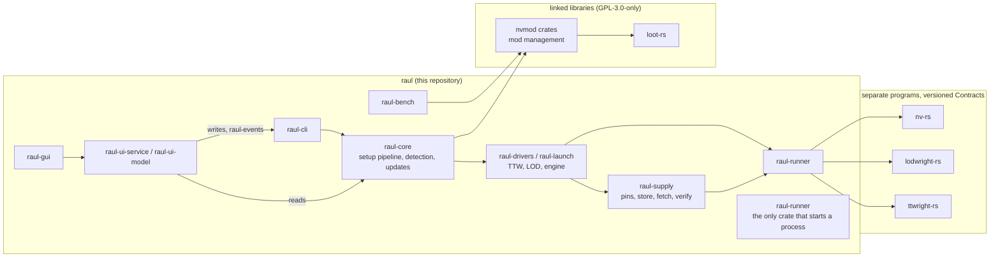
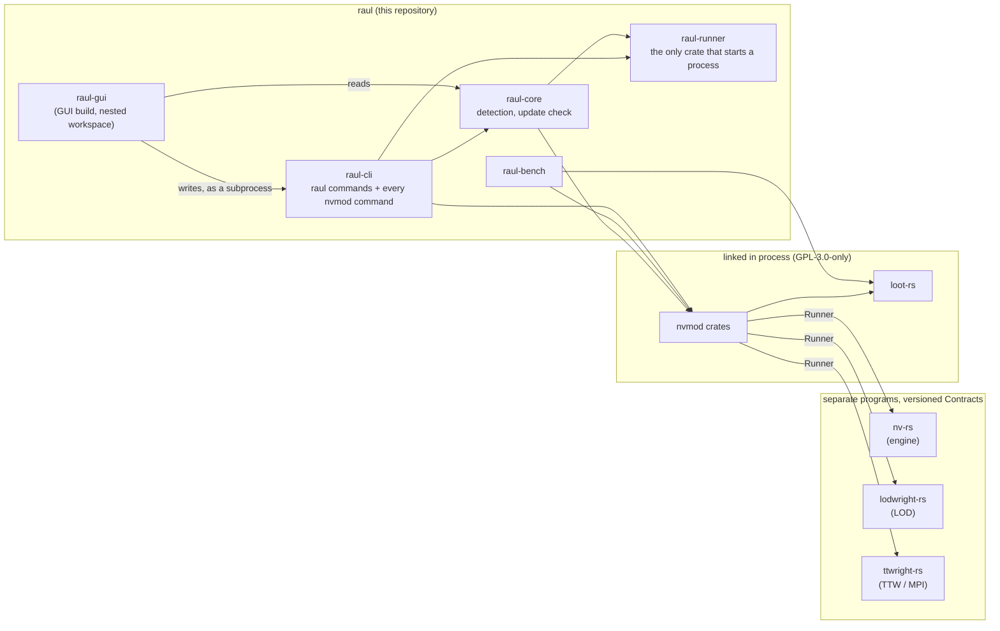

# Architecture

How the Toolbox and its Components fit together. Terms are defined in [GLOSSARY.md](../GLOSSARY.md); the decisions
behind this shape are [ADR-0001](adr/0001-the-toolbox-is-the-product-umbrella.md) to
[ADR-0006](adr/0006-native-on-linux-windows-and-macos-with-no-compatibility-layers.md).

## Where this is going

[ADR-0007](adr/0007-orchestration-tool-supply-and-the-view-model-live-in-the-toolbox.md) to
[ADR-0011](adr/0011-the-rolling-engine-channel.md) move orchestration, tool supply, the Runner, the view model and
the GUI from nvmod into the Toolbox; [REORG.md](REORG.md) has the crate-by-crate plan and the order.
[ADR-0016](adr/0016-components-are-incorporated-libraries-called-in-process.md) links every Component in process, and
[ADR-0019](adr/0019-raul-orchestrates-nvmod-manages-mods.md) makes `raul` the orchestrator of every flow, with nvmod
managing mods only; where the diagrams below show the Runner starting Components, those ADRs win. The target:

The rest of this page describes the code as it is today, before the moves.

## Pieces

- **raul-core** owns what is the Toolbox's alone: finding game copies and the update check. Everything about Instances, Mods, Profiles and the Load order is nvmod's, used by path from
  `components/nvmod-rs`.
- **raul-cli** is the `raul` program. Its own commands are `version`, `detect`, `bench` and
  `update`; every other command is nvmod's and runs in process through `nvmod_cli`.
- **raul-gui** (after the GUI moves from nvmod-rs, ADR-0003) reads through raul-core in process and runs
  long or risky work as a `raul` subprocess that streams progress events, so a crash in an install never closes
  the window.
- **raul-runner** is the Toolbox's one subprocess Runner (argument vector, no shell, scrubbed environment,
  timeout, output cap), copied with its history from nvmod-rs. It is the only Toolbox crate that may use
  `std::process::Command`: `clippy.toml` forbids `Command::new` elsewhere and the guard test
  `crates/raul-runner/tests/no_command_elsewhere.rs` catches the other ways in. `raul update check` (`curl`) goes through it.
- **Components** that run as separate programs are started by nvmod's own copy of the Runner until those drivers
  move here (`docs/REORG.md` section 10.2), and speak versioned JSON Contracts.

## Data flow: from a game copy to a running game

1. **Detect** (`raul detect`): find Fallout: New Vegas (and Fallout 3 for TTW) in Steam, GOG or Epic folders, or
   a folder the person picks; check the executable version and the DLC. Read only.
2. **Instance** (`raul init`, nvmod): make an Instance from the base copy. The base copy is never written.
3. **TTW** (`raul ttw`, ttwright-rs running in raul's own process): optional; installs the Tale of Two Wastelands MPI package from
   the person's own Fallout 3 and New Vegas copies, with progress and resume.
4. **Mods** (`raul install`, `raul mods`, `raul profile`, nvmod): install from archives or folders into the
   Instance, enable and disable per Profile, and show conflicts. Every change keeps a restore point (Rollback).
5. **Load order** (`raul sort`, nvmod with loot-rs): compute the order from the Staging tree and the LOOT
   masterlist, show the Plan, apply it only when asked; locked plugins keep their place.
6. **LOD** (`raul lod`, nvmod driving lodwright-rs): build distant terrain, object and tree LOD into the Instance,
   reusing blocks that are up to date.
7. **Launch** (`raul run`, nvmod driving nv-rs): start the Staging tree on nv-rs, natively. Where nv-rs is not
   native yet, Launch is disabled (ADR-0006).

## Versions

The Components are submodules under `components/`, each pinned to a release version; the submodule pins and the
lock files are the set of Component versions (ADR-0018). CI checks that every pointer is a release tag or on its
repository's default branch. The `Components` workflow (`components.yml`) runs a self-hosted Renovate when a Component's release
workflow sends a `component-release` dispatch, and on a 15-minute schedule as a safety net, because GitHub delays and
drops scheduled runs (`.github/renovate-components.json`). It finds a new release of a Component's repository itself (the
dispatch carries no data) and opens a pull request that moves only that Component: the submodule pointer, with both lock files
refreshed. Renovate lists files with git and never sees inside a submodule, so the release a pointer is at is also
written in `components/<repo>.version`; `scripts/bump-component.sh` keeps it equal and CI fails when it drifts. nvmod moves with the loot-rs it links (ADR-0015). Pipeline Complete decides whether the pull request merges,
and auto-merge lands it. The release (`release.yml`) packages `raul` with the Component programs at those pins.

## Crate graph rules

A test (`crates/raul-core/tests/crate_graph.rs`, run in pull-request CI with the workspace tests) reads each crate's
`[dependencies]` and fails on a forbidden edge (REORG section 3):

- `raul-runner` (and `raul-supply`, once it is split out) depends on no other `raul-*` crate.
- `raul-ui-model` depends on no `raul-*` and no `nvmod-*` crate.
- `raul-gui` reaches nvmod only through `raul-ui-service`. It still links `nvmod-modinstall` and `nvmod-run`
  directly; the test lists them as debt that may only shrink.

## Workspaces and lock files

| Workspace | Lock file | Builds |
| --- | --- | --- |
| root `Cargo.toml` | `Cargo.lock` | raul-core, raul-cli (CLI-only `raul`), raul-bench, raul-runner, and the nvmod and loot-rs crates they link |
| `crates/raul-gui` (to come) | its own | the release `raul`: the same CLI plus the GPUI GUI (ADR-0004) |
| each Component | its own | built from `components/<name>` with `--manifest-path`, never as a member here |
