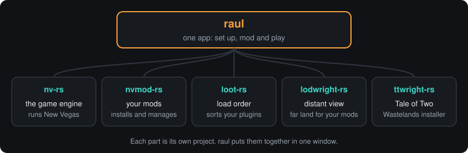

# raul's Components

raul is made of five Components, each in its own repository with its own history, issues, releases and CI:

| Component | What it does |
| --- | --- |
| [nv-rs](https://github.com/JorisJonkers-dev/nv-rs) | The engine (this organisation's fork of [slaterain/nv-rs](https://github.com/slaterain/nv-rs)) |
| [nvmod-rs](https://github.com/JorisJonkers-dev/nvmod-rs) | Mod management: instances, profiles, mod installs, staging, conflicts, load order, content Doctor |
| [loot-rs](https://github.com/JorisJonkers-dev/loot-rs) | Load-order sorting against the LOOT masterlist |
| [lodwright-rs](https://github.com/JorisJonkers-dev/lodwright-rs) | Distant terrain, object and tree LOD generation |
| [ttwright-rs](https://github.com/JorisJonkers-dev/ttwright-rs) | Tale of Two Wastelands installation from the player's own game copies |

  

**Why they are separate.** Each Component does one job, works and is tested on its own (each has its own command
line), and releases when it is ready. raul links them all into one program and calls them in its own process; only the
game itself runs as a separate process, started from raul's own binary. A raul release pins one set of Component
versions that were tested together ([ADR-0001](adr/0001-the-toolbox-is-the-product-umbrella.md),
[ADR-0018](adr/0018-the-submodule-pins-are-the-set.md),
[ADR-0016](adr/0016-components-are-incorporated-libraries-called-in-process.md),
[ADR-0019](adr/0019-raul-orchestrates-nvmod-manages-mods.md)). How they fit together in the code is in
[ARCHITECTURE.md](ARCHITECTURE.md).

## Origins

The engine is [nv-rs](https://github.com/slaterain/nv-rs) by slaterain, the Rust port of Fallout: New Vegas; raul uses
the JorisJonkers-dev fork of it, which replays upstream's work regularly and keeps its licence, attribution and legal
notice. Load-order sorting follows the rules and masterlist of the [LOOT](https://loot.github.io/) project, which
loot-rs reads at run time and does not redistribute. ttwright-rs is a rewrite of
[SulfurNitride/TTW_Linux_Installer](https://github.com/SulfurNitride/TTW_Linux_Installer).
