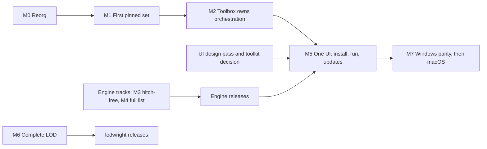

# Reorganisation plan: one division of work for the stack

Status: **proposed, 2026-11-16, waiting for the owner's approval.** Nothing in this plan has been moved, renamed,
closed or transferred yet. Section 10 lists the steps that run after approval, each as a small pull request.

Terms follow [`GLOSSARY.md`](../GLOSSARY.md). Ticket numbers are written `repo#N`; a plain `#N` is a ticket in this
repository. Tickets of the owner's private workshop are counted here but not listed; their dispositions are recorded
in the workshop.

## 1. Why

The stack works, but its division of work grew by accident:

- **nvmod-rs owns too much.** It is the mod manager, and it is also the product's orchestration: the setup
  pipeline, the TTW, LOD and engine drivers, the pin file of external tools and their fetch and verification, the
  update model, the run settings, the GUI's view model and the GUI itself. The Toolbox, which is meant to be the
  product, is thin glue over it.
- **Two pin files.** nvmod's `tools.lock.toml` pins the external tools; the Toolbox's earlier Component pin file repeated
  the submodule pins. They described the same thing twice and could disagree (removed, ADR-0018).
- **Contracts in three places.** Schemas are defined by their producers, snapshotted in nvmod's `contracts/`, and
  checked by a compatibility matrix in the private workshop.
- **Two benchmark front doors.** `raul bench` (synthetic) and the nv-rs fork's `nv-rs-dev bench` (in game) overlap
  in name and report format but not in what they measure.
- **Tickets away from their code.** Most mod-manager and GUI tickets sit in the private workshop, while the code is
  public.
- **Local tooling in no repository.** The launcher wrapper, the developer wrapper and the build limiter live only on
  the owner's machine.

## 2. Principles of the division

1. **The Toolbox contains the tools.** Everything that takes a player from a game copy to a running modded game, and
   keeps it working, is the Toolbox's: orchestration, tool supply, updates, the UI and its view model, the
   stack-wide Doctor, the end-to-end run, packaging and the bench front door.
2. **A Component does one job and is usable alone.** nv-rs runs the game. nvmod manages mods. loot-rs sorts.
   lodwright-rs builds LOD. ttwright-rs installs TTW. Each has a CLI that works without the Toolbox, and none of them
   finds, fetches or launches another Component.
3. **Dependencies point one way:** Toolbox → nvmod → loot-rs. nv-rs, lodwright-rs and ttwright-rs are run as
   processes by the Toolbox, never linked (ADR-0002 stands for these).
4. **The producer owns its Contract.** A Component defines and versions the schemas of what it emits and publishes
   them with its release. The Toolbox owns the registry of which versions work together, the snapshots and the
   compatibility check.
5. **One set of pins.** The submodule pins and the lock files are the only place that says which Component versions
   belong together (ADR-0018). The Rolling channel does not break this: a newer engine build is offered only when
   every Contract version it emits is one the current set's consumers accept, and the engine a player runs is that
   player's local state, not a pin.
6. **The private workshop holds research and decisions only.** No code tickets, no code that ships.
7. **Rust native.** Shipped code, and the checks that gate a release, are Rust. Python stays only in research and
   one-off scripts (section 9). One recorded exception until its port lands in M3: the fork's in-game bench harness.
8. **Linux first.** Windows is kept green by CI; Windows parity work starts after the Linux milestones. macOS after
   Windows.

## 3. Capability to home

| Capability | Home | Change |
| --- | --- | --- |
| Engine: running the game, platform layers (window, input, sound, files), renderer on wgpu | nv-rs (fork) | stays |
| Performance and threading of the engine, hitch recorder, memory timeline | nv-rs | stays |
| Built-in script extender commands, Engine extension API and SDK | nv-rs | stays |
| Render injection: loose shader overrides, post-process chain, effect packs | nv-rs | stays |
| In-game benchmark harness (scenarios, drivers, lock, baselines, `summary.json`) | nv-rs | stays; ported to Rust over time; reports through the bench Contract |
| Engine Contracts: `release-manifest`, `capabilities`, `run-options`, bench `summary` | nv-rs | stays (producer) |
| Instance, Profile, Mod model and its schema | nvmod-rs | stays |
| Mod install, FOMOD, mod lifecycle, `meta.ini`, separators, categories | nvmod-rs | stays |
| Staging tree, conflicts, archive (BSA) conflicts, overwrite | nvmod-rs | stays |
| Plugins and Load order (links loot-rs), minimal-change sort | nvmod-rs | stays |
| Backups, saves, MO2 import, Nexus client, downloads library, mod updates | nvmod-rs | stays; mod update rows are an nvmod report the Toolbox shows |
| Content Doctor: NVSE plugin catalogue, readiness per category from a given `capabilities.json`, opcode usage scan | nvmod-rs | stays; takes the engine's capability file as input data, never fetches it |
| Executables registry (which programs a Profile can start) | nvmod-rs | stays as data; starting them moves to the Toolbox |
| Load-order sorting library, masterlist | loot-rs | stays (the owner's own track) |
| LOD generation, its request, plan, result and event Contracts | lodwright-rs | stays |
| TTW installation from the player's own copies, its result and event Contracts | ttwright-rs | stays; its own GUI is dropped |
| Setup pipeline (detect, Instance, TTW, mods, sort, LOD, launch) with journal and resume | Toolbox | **moves from nvmod** |
| Drivers of the process Components (TTW, LOD, engine install, engine check, launch) | Toolbox | **moves from nvmod** |
| Subprocess Runner (argument vector, no shell, scrubbed environment, limits, process-tree kill, sandbox) | Toolbox | **moves from nvmod** with its callers |
| Tool supply: pins, fetch, checksum and attestation check, content-addressed store, side-by-side install, Rolling channel, pointer rollback | Toolbox | **moves from nvmod**; `tools.lock.toml` folds into `supply.toml` |
| Updates listing (engine builds, Components, masterlist, LOD staleness, mod rows from nvmod) | Toolbox | **moves from nvmod** (never built there) |
| Run settings per Profile, Play sheet, launcher features (VRAM watchdog, HUD, desktop hints), shader warm-up | Toolbox | **moves from nvmod and from the local wrapper** |
| View model and service seam of the GUI | Toolbox | **moves from nvmod** (`nvmod-ui-model`, `nvmod-ui-service`) |
| The GUI | Toolbox | moves from nvmod (already planned, #12) |
| Stack Doctor (gathers each Component's checks into one report), support bundle, logs view | Toolbox | **new / moves** |
| Contract registry and snapshots, compatibility check, end-to-end run, release gate | Toolbox | compat and e2e move from the workshop (#21), rewritten in Rust |
| Bench front door (`raul bench`): synthetic suite, Component micro-benches, ingest of in-game `summary.json` | Toolbox | stays; gains in-game ingest |
| Installers, update check of `raul` itself, signing, Nix packaging of the product | Toolbox | stays; Nix packaging of the GUI moves from nvmod |
| Detection of game copies | Toolbox | stays (ttwright and nvmod keep only what their own CLI needs) |
| Research, owner decisions, private data seams, the MO2 cut-over oracle on real data | private workshop | stays; code tickets leave |
| Developer launcher and build limiter on the owner's machine | Toolbox (`raul dev`) and the workshop | section 6.5 |

### What nvmod-rs looks like afterwards

The crates that stay: `nvmod-core`, `nvmod-instance`, `nvmod-profile`, `nvmod-formats`, `nvmod-modinstall`,
`nvmod-stage`, `nvmod-conflicts`, `nvmod-bsa`, `nvmod-plugins`, `nvmod-loadorder`, `nvmod-backup`, `nvmod-saves`,
`nvmod-import`, `nvmod-catalog`, `nvmod-doctor` (content checks only), `nvmod-pe`, `nvmod-runlog`, `nvmod-testkit`,
`nvmod-fixtures` and the CLI with the mod-management commands.

What moves, crate by crate. `nvmod-install` installs the **engine** (it builds nv-rs or fetches its release and runs
the installation check); installing **mods** is `nvmod-modinstall`, which stays.

| nvmod-rs today | Capability | Toolbox crate | `raul` command |
| --- | --- | --- | --- |
| `nvmod-runner` | subprocess Runner | `raul-runner` | — |
| `nvmod-tools` (lock, store, fetch, verify, trust, contract negotiation, LOD and TTW adapters) | tool supply and drivers | `raul-supply` (pins, store, fetch, verify) and `raul-drivers` (TTW, LOD, engine) | `raul tools`, `raul ttw`, `raul lod` |
| `nvmod-install` | engine install and check | `raul-drivers` | `raul engine install`, `raul engine check` |
| `nvmod-run`, launch part (`program.rs`, the native launch plan) | launch | `raul-launch` | `raul run` |
| `nvmod-run`, registry and Instance lock | which programs a Profile can start | stays in nvmod (split out first as `nvmod-exec`) | `nvmod exec` |
| CLI `setup.rs`, `setup_state.rs`, `verify.rs`, `profile_apply.rs` | setup pipeline with journal and resume | `raul-core` | `raul setup`, `raul verify` |
| `nvmod-ui-model`, `nvmod-ui-service` | view model and service seam | `raul-ui-model`, `raul-ui-service` | — |
| `gui/` | the GUI | `raul-gui` (nested workspace) | `raul` with no arguments |
| `contracts/`, `tools.lock.toml` | snapshots and pins | `contracts/`, `supply.toml` | — |

The CLI commands `setup`, `ttw`, `lod`, `install-nv-rs`, `run`, `tools`, `verify` and `contracts` move to `raul`.
They are removed from nvmod when they move (section 12, decision 5); only `raul` has them afterwards. After M2 nvmod starts no subprocess at all: its test that forbids `std::process::Command` keeps
running with no exceptions. If a later need arises, it is decided then; nvmod never depends back on the Toolbox.

### The Toolbox's own crate graph

```text
raul-gui ──► raul-ui-service ──► raul-ui-model
   │               │
   │               └──(writes: a `raul` subprocess, raul-events)──► raul-cli
   ▼
raul-cli ──► raul-core ──► raul-drivers ──► raul-supply ──► raul-runner
                 │              │
                 │              └──► raul-launch ──► raul-runner
                 └──► nvmod crates (libraries only) ──► loot-rs
raul-bench ──► nvmod crates, loot-rs        (never raul-gui)
```

Rules, checked in CI by a dependency-graph test: `raul-runner` and `raul-supply` depend on no other `raul-*` crate;
`raul-ui-model` depends on nothing that starts a process; only `raul-runner` may use `std::process::Command`;
`raul-gui` reaches nvmod only through `raul-ui-service`. Path dependencies into `components/nvmod-rs` resolve against
that submodule's own workspace (section 4.3 of the plan); the nested GUI workspace has its own lock file and
`cargo deny` allow-list, and pull-request CI builds it whenever a path under `crates/raul-gui` or a crate it depends
on changes. The parity test between the two `raul` builds compares parsed argument definitions (flags, arity,
subcommands), not only command names.

### One writer

The GUI reads in process and writes through a `raul` subprocess (ADR-0003). To keep the two views equal: every
mutation is observed only through the subprocess's `raul-events` stream and the journal it writes; after an event
that changes state, the in-process read model reloads what that event names from disk. Nothing in the GUI caches
state across a write.

## 4. Moves, merges, splits and retirements

| What | From | To | Kind |
| --- | --- | --- | --- |
| Orchestration, tool supply, Runner, view model, GUI (section 3) | nvmod-rs | Toolbox | move with history (section 10.2); a crate that only partly moves is first split inside nvmod-rs so every move is a whole directory; a moving path is frozen (bug fixes only) from its split until the removal pull request lands |
| `tools.lock.toml` | nvmod-rs | `supply.toml` and the submodule pins | merge: the Component versions are the submodule pins and the lock files (ADR-0018); `supply.toml` (generated, checked) holds per-platform asset URL, checksum and attestation identity for each version a pin names. The active Rolling-channel engine is the player's local state, not a pin |
| Contract snapshots (`contracts/`) | nvmod-rs | Toolbox `contracts/` | move; the compatibility check reads them |
| Compatibility matrix, its check and the release gate | workshop | Toolbox | move and rewrite in Rust as `raul e2e` |
| Synthetic end-to-end run | workshop | Toolbox | move and rewrite in Rust (`raul e2e`) |
| Workshop ADRs on the GUI home, the user-facing release and packaging | workshop | Toolbox ADRs 0001 to 0006 | mark superseded (already decided) |
| The TTW installer's own GUI | ttwright-rs | — | retire; `raul` is the one UI |
| ttwright-rs single crate | ttwright-rs | workspace: core, CLI, Contract, testkit | split (ttwright-rs#5) |
| The launcher wrapper's features | owner's machine | Toolbox (`raul run`, `raul dev`) | move (section 6.5) |
| The developer wrapper | owner's machine | nv-rs `scripts/fork/local/` (already there; the machine wrapper becomes a one-line shim) | stays |
| The build limiter and its slice | owner's machine | workshop `tools/local/` | record, private (machine-specific) |
| Shared format readers (plugin headers, BSA, executable version) | five repositories | — | stay separate for now; the golden-vector check (#26) runs first; a shared leaf crate in a new repository is decided after it (section 12, decision 4) |

No repository is renamed or archived by this plan. No new repository is required; one may follow from open
question 4.

## 5. Ticket dispositions

Counts are of open tickets on 2026-11-16. "Keep" means the ticket stays where it is with its current scope; only
changes are listed. Every closed ticket gets a comment naming its evidence or its new home. Moves are recreated in
the new repository and the old ticket is closed with "Moved to <repo>#N"; GitHub cannot transfer between the
private workshop and public repositories.

### 5.1 nv-rs (199 open)

Close as done, with the evidence found in merged work:

| Ticket | Evidence |
| --- | --- |
| nv-rs#119 | sync verification and blocked-sync report (nv-rs#22, nv-rs#25) |
| nv-rs#123 | Linux file-path code in an overlay file (nv-rs#21) |
| nv-rs#126 | typed shader family sharded across three jobs (nv-rs#73) |
| nv-rs#171 | sound output on Linux (nv-rs#55, nv-rs#64; `docs/fork/LINUX.md`) |
| nv-rs#174 | Linux tarball, installer, launcher and Nix flake (nv-rs#26, nv-rs#65) |
| nv-rs#181 | shader compiler off Windows (nv-rs#38, nv-rs#39) |
| nv-rs#182 | machine tables of a Linux machine (nv-rs#48) |
| nv-rs#183 | GPU tests on lavapipe (nv-rs#30, nv-rs#42); the close note says nv-rs#198 (the 8x multisampling failures it found) stays open |
| nv-rs#196 | Direct3D 9 recorder off Windows, headless frame on wgpu (nv-rs#50) |
| nv-rs#197 | window layer for X11 and Wayland (nv-rs#40) |
| nv-rs#199 | the game's window and input wired to the window layer (nv-rs#53) |
| nv-rs#221 | stream with an explicit channel map and underrun reports (nv-rs#64) |
| nv-rs#226 | memory timeline behind `NV_MEMLOG` (nv-rs#70, nv-rs#86) |
| nv-rs#229 | pipeline cache cap, eviction log, content-addressed cache (nv-rs#104, nv-rs#115, nv-rs#316); its unshipped residency half (read-back byte cap, bind-group de-duplication) is carried into nv-rs#241 and nv-rs#250 before it closes |
| nv-rs#211 | the game's window handles mapped to the window layer (nv-rs#53); closed only after its acceptance is checked against that change |
| nv-rs#132 | the opcode usage scan of an installed list exists in nvmod (`nvmod nvse-usage`, nvmod-rs#46) |

Kept open with a new acceptance line: nv-rs#130 (the fix is in the tree; close with the next green nightly as
evidence).

Merge (close the first into the second, carrying any missing acceptance criteria across):

| Ticket | Into | Why |
| --- | --- | --- |
| nv-rs#200 | nv-rs#213 | same Wayland pointer lock and cursor hold; nv-rs#200's relative-motion criterion is carried across |
| nv-rs#201 | nv-rs#214 | resize, refit and minimised state after creation; its refresh-rate part goes to nv-rs#248 |
| nv-rs#129 | nv-rs#149 | both move the Linux-clean engine jobs to Linux and settle the Windows cadence |
| nv-rs#179 | nv-rs#291 | one scheduled bench run with trend storage, on CI-adjacent hardware |
| nv-rs#215 | nv-rs#248 | refresh rate and present pacing are one piece of work |
| nv-rs#202 | nv-rs#216, nv-rs#217 | gamepad and text input, each already its own ticket |
| nv-rs#167 | nv-rs#284 | the loose shader override loader |
| nv-rs#257 | nv-rs#230 | one sanitiser soak job with one suppression policy |
| nv-rs#279 | nv-rs#278 | one Windows measurement-parity ticket |
| nv-rs#275 | nv-rs#320 | the cache cap and keying shipped; what is left is proving the stutter is gone |
| nv-rs#323 | nv-rs#324 | the same freeze; nv-rs#323's check becomes nv-rs#324's acceptance criterion |
| nv-rs#260, nv-rs#261 | nv-rs#322 | the harness and prototype landed; the verdict document is what remains |

Move:

| Ticket | To | Why |
| --- | --- | --- |
| nv-rs#166 | nvmod-rs | catalogue entries for unrecorded extender DLLs are content-Doctor data |

Park (label `parked`, kept open, with the condition that reopens the work):

| Tickets | Condition |
| --- | --- |
| nv-rs#262, nv-rs#263, nv-rs#264 (Vulkan-native S1 to S3) | the S0 verdict is "stop" (wgpu costs 1.0 to 1.8 µs a draw, under the 3 µs threshold); reopen when a replay-bench run on the walking route under the lock measures more than 3 µs a draw |
| nv-rs#244 (parallel command recording on wgpu) | reopen when nv-rs#241's counters show command recording as the largest draw-side cost on the main thread |
| nv-rs#246 (hot reload), nv-rs#247 (WASM tier) | after the extension host (nv-rs#235) and pilot (nv-rs#249) |
| nv-rs#301 (TAA spike) | after the post-process chain and reference effects |
| nv-rs#175, nv-rs#278, nv-rs#295 | Windows milestone (M7); only tickets whose deliverable is Windows parity are parked, not Linux CI work that carries the label (nv-rs#129, nv-rs#149, nv-rs#210 stay open) |
| nv-rs#137, nv-rs#139, nv-rs#145 (Wine-based oracles on a restricted runner) | when the restricted runner exists (nv-rs#133); Proton and Wine are reference oracles only |
| nv-rs#220 (multichannel research) | answered enough for the port by nv-rs#64; reopen when a stage of nv-rs#219 (nv-rs#223, nv-rs#224) needs a game behaviour it does not cover |

Not parked, although the Vulkan verdict has been cited for them: the render-injection tickets (nv-rs#188, nv-rs#189, nv-rs#190,
nv-rs#284, nv-rs#302 and their chain), wgpu parity on RADV (nv-rs#168) and render-side DLL patches as fix rows
(nv-rs#169). The Vulkan verdict stops a second renderer, not effects on the wgpu renderer;
nv-rs#188 and nv-rs#302 are owner decisions, and loose shaders are part of running the full mod list.

The extender families for the first extender (nv-rs#136 to nv-rs#154) stay open but are worked at upstream's pace:
upstream owns those command sets, so each one starts with a check of upstream's main and the fork branch. The
commands the owner's list actually uses are the second and third extenders' (nv-rs#274, nv-rs#303 to nv-rs#313),
which upstream does not build; those lead.

### 5.2 nvmod-rs (2 open), lodwright-rs (24), ttwright-rs (3), loot-rs

- **nvmod-rs:** nvmod-rs#70 (Release test) is finished early (section 8). nvmod-rs receives 16 tickets
  recreated from the workshop: the mod-management work (incremental staging, profile management, overwrite capture
  and management, interactive FOMOD, downloads library, Nexus client, mod info and update rows, update apply,
  link handler and download manager, hooks, minimal-change sort, user catalogue overlay, catalogue classes and
  shader-pack rows, Engine extension packaging, per-category readiness), plus nv-rs#166. Two internal clean-ups are
  filed with them: the Load order crate depends on the mod-install crate, which is backwards (the rollback journal
  they share becomes its own small crate); and the extender opcode-block table sits in the CLI crate instead of the
  catalogue.
- **lodwright-rs:** close as done lodwright-rs#25 to lodwright-rs#28 (measurements recorded in the provenance
  table, lodwright-rs#55, lodwright-rs#61, lodwright-rs#68), lodwright-rs#35 to lodwright-rs#41 and lodwright-rs#43
  (lodwright-rs#66, lodwright-rs#67, lodwright-rs#70 to lodwright-rs#73, lodwright-rs#79, lodwright-rs#84; each close
  names the test that proves it). Merge lodwright-rs#34 into lodwright-rs#86 (border and unseen-face work is part of
  the remaining differences) and lodwright-rs#78 into lodwright-rs#82 (the in-game check is part of the Release test).
  Keep lodwright-rs#44 (BSA packing), the provenance tickets lodwright-rs#51 to lodwright-rs#62 and lodwright-rs#86.
  New tickets for what complete LOD still lacks: `lodwright-verify` in the Contract handshake, with its exit codes
  documented; object progress events; dropping object faces under terrain and water; crack protection between LOD
  levels at block borders; per-texture tiling scale in terrain textures; an alpha channel for specular maps; how the
  game picks up generated LOD (loose files against an archive), separate from BSA packing. lodwright-rs#82 gains the
  written Release-test checklist it is still missing.
- **ttwright-rs:** keep ttwright-rs#5 and ttwright-rs#6. ttwright-rs#5 gains: a versioned result and event Contract
  (today's progress is an unversioned in-process callback with fixed bands), cancellation and resume, and removal of
  the eframe GUI.
- **loot-rs:** unchanged by this plan. The two requests that touch it (a stable header API and default placement
  helper; the minimal-change sort) are written up for the owner's own track and not filed by this plan.

### 5.3 Toolbox (18 open)

| Ticket | Disposition |
| --- | --- |
| #11 | keep; first in the release order (section 8) |
| #12 | widen into the epic "Move orchestration, tool supply, the Runner, the view model and the GUI from nvmod-rs", with one sub-ticket per row of the crate table (section 3); the view model and service seam move early, toolkit-agnostic; the GUI itself moves after the design pass, and only its toolkit-free parts (ADR-0012), so its history is not moved and then thrown away |
| #13, #15, #16 | keep; depend on the epic's GUI step |
| #14 | rescope: the service seam moves here; reads in process, risky writes as a `raul` subprocess (ADR-0003 unchanged on this point) |
| #17, #18, #19, #22, #24, #25 | keep |
| #20 | rescope: the in-game case ingests nv-rs `summary.json` produced under the bench lock; `raul bench` never starts the game itself |
| #21 | keep; the move is a Rust rewrite, not a copy of the Python |
| #23 | close, superseded: once tool supply is here, nvmod never looks for Component programs |
| #26 | keep; absorbs the workshop's golden-vector ticket |
| #27 | keep, updated after the reorganisation |

New Toolbox tickets (recreated from the workshop or new): the orchestration epic's sub-tickets; one pin file;
Contract registry and handshake index; updates listing and its Contract; Updates page; run settings and Play sheet;
launcher features from the local wrapper; shader warm-up on launch; LOD staleness row; logs view; support bundle;
GUI parity screens; Windows GUI job (after the Nexus milestone); Nix packaging of the product; Runner process-tree
kill and Linux sandbox profiles; Windows Job Object limits; Runner `OsString` arguments; streaming Runner without
the remaining `Command` exceptions; licence boundary checks; UI rules and the vanilla-style design (section 11);
the `raul-events`, `raul-doctor` and `raul-detect` Contracts; the crate-graph test; an in-game Toolbox Release test.

Defects found in the Toolbox while mapping it, each a new ticket:

- the command-parity test ADR-0004 promises does not exist (the list of the Toolbox's own commands has no reader);
- the `plugin-headers` bench case only reads files and parses no header;
- the Contract versions the Toolbox recorded per set were parsed but never checked against the Components (the file
  is removed, ADR-0018);
- `raul update check` starts `curl` outside the Runner's rules (no output cap or scrubbed environment);
- the pin of a Component is worked out twice (the submodule script and the bump workflow);
- `raul bench --quick` takes the upper of the two middle runs as the median, and the bench names do not change when
  what a case measures changes;
- the update check compares versions by a hand-written prefix rule that ignores pre-release and build parts.

### 5.4 The private workshop (65 open)

15 are already done by merged work and are closed with their evidence; 5 merge into Toolbox tickets; 21 move to the
Toolbox and 16 to nvmod-rs (sections 5.2 and 5.3); one public-safety pass moves to nv-rs; 7 stay as research, owner
decisions or the private real-data seam. The per-ticket table is kept in the workshop.

## 6. Overlaps resolved

### 6.1 nvmod and UI tickets in the workshop

They follow their code: mod-management tickets to nvmod-rs, orchestration and UI tickets to the Toolbox (section 5).
The workshop keeps only research, owner decisions and the private real-data seam.

### 6.2 Compat, e2e and the release gate versus the pinned Component set

One mechanism, here: the submodule pins and the lock files are the set (ADR-0018); `contracts/` holds the snapshots of
every Contract version a set speaks; `raul e2e` (synthetic fixtures, no game data) and a Component's Release test (run
on the owner's machine) gate the Component release that feeds the bump. The workshop's matrix, check and gate are retired after the Rust versions run in CI. The
behaviour of the Rolling channel amendment is kept: nv-rs alone may move ahead of the set, with a capabilities diff,
side-by-side install and pointer rollback, now implemented in the Toolbox's tool supply.

### 6.3 `raul bench` versus `nv-rs-dev bench`

They measure different things and stay two programs behind one front door:

| | `nv-rs-dev bench` (nv-rs) | `raul bench` (Toolbox) |
| --- | --- | --- |
| Measures | frame time, p99, hitches, RSS, VRAM in the game | sorting, plugin reads, installs, LOD steps on synthetic data; Component micro-benches |
| Runs | only under the machine-wide bench lock, in the nested headless session, with the VRAM watchdog | anywhere, including CI |
| Writes | `summary.json` (bench Contract, published by nv-rs, nv-rs#231) | `bench.json` and `bench.md`; history on `gh-pages` |

`raul bench ingest <summary.json>` reads in-game results into the same report and history. `raul bench` never starts
the game. The in-game harness (today Python, standard library only, under the fork's `scripts/fork/bench/`) is
ported to a fork-owned Rust crate as its own nv-rs ticket, after nv-rs#325 lands and after its outputs have a
versioned Contract.

### 6.4 Contracts in three places

Producer-owned schemas, a registry here (principle 4). Each Component keeps `contracts/<name>.v<N>.json` and
answers `<tool> contracts --json`; the Toolbox snapshots each version a pinned set speaks and fails a bump whose
snapshot differs from the pinned release. The workshop's contract tickets move here (registry, handshake index) and
to the producers (each producer's own schema work). nvmod keeps only its own Contracts (the Instance schema, the
mod update report, `nvse-usage`).

| Contract | Producer | State on 2026-11-16 | Work |
| --- | --- | --- | --- |
| `nv-rs-release-manifest` v1, `nv-rs-capabilities` v1 | nv-rs | schema checked in, published | snapshot here |
| `nv-rs-run-summary` | nv-rs | written by the hitch recorder; versioned by a string, no schema file | integer `schema_version` and a schema file |
| bench `summary.json`, suite, baseline and matrix files | nv-rs | no schema, no version | one bench Contract v1 (nv-rs#231) before `raul bench ingest` |
| `run-options` | nv-rs | does not exist yet | nv-rs#231; the Toolbox's run settings read it |
| `lodwright-plan`, `-result`, `-request`, `-manifest` v1, events | lodwright-rs | published; `lodwright-verify` is emitted but missing from the handshake | add it to the handshake |
| `loot-sort` v1 | loot-rs | published | snapshot here |
| `ttw-installer-result` | today a normalising wrapper in nvmod | ttwright-rs has only an unversioned in-process progress callback | ttwright-rs defines result and event Contracts (ttwright-rs#5); the wrapper is retired |
| `nvmod-updates` (mod rows), Instance and Profile schemas | nvmod-rs | the schemas exist; the update rows do not | mod update rows as an nvmod report |
| `raul-plan` (the plan a write shows before it applies: steps, files touched, restore point, reversibility) | Toolbox | does not exist; lodwright's plan, nvmod's sort plan and the setup plan are its inputs | M2; every GUI review screen renders it |
| `raul-journal` (on disk: the resumable setup journal) | Toolbox | nvmod's setup state file, unversioned | M2, before the setup pipeline moves |
| `bench.json` and the bench history rows | Toolbox | `bench.json` carries a `schema_version`; history rows carry no machine or version identity | M3, with ingest |
| `raul-events` (progress and state-change events of a `raul` subprocess) | Toolbox | does not exist; nvmod's `setup --json` events are its seed | before the view model moves (M2) |
| `raul-doctor` (the stack Doctor report gathering each Component's checks) | Toolbox | does not exist | M2 |
| `raul-detect` (detected game copies) | Toolbox | `raul detect --json` exists without a schema | M2; Components take the detected paths as arguments and never scan when driven by `raul` |
| `raul-updates`, setup journal, run settings | Toolbox | do not exist yet | M2 and M5 |

A Contract without a row here cannot be part of a pinned Component set. When the `contracts` command moves to `raul`,
nvmod keeps answering `nvmod contracts --json` for its own schemas.

### 6.5 Local wrappers

- The launcher wrapper's features (VRAM watchdog, HUD, desktop hint, run header) become `raul run` features; its
  developer form (run the newest local engine build) becomes `raul dev run --engine <path>`. The wrapper then
  shrinks to a one-line shim and is deleted after a release.
- The developer wrapper already lives in nv-rs `scripts/fork/local/`; the machine copy is a shim.
- The build limiter and its systemd slice are specific to the owner's machine and are recorded in the workshop.

### 6.6 Stale lodwright-rs tickets

Section 5.2.

## 7. Milestones, dependencies and gates

The numbers that decide the order (from the fork's quick bench suite and profiles, 2026-11-16):

- the game is CPU bound: the main thread is about 96% busy;
- in the dense town the loader takes 20 to 27% of it, scripts 11%, the audio manager 7%, the HUD 5%;
- in the first room the typed shader batch takes 33%;
- the renderer is not the limit: wgpu costs 1.0 to 1.8 µs a draw, under the 3 µs stop threshold of the Vulkan plan;
- nv-rs builds 0 of the 38 extender commands the owner's list uses;
- LOD is close: 291 of 295 object blocks match exactly, water IoU 0.905 to 0.986.

So: performance work goes to the main thread (loader, asset decode, scripts, audio, shader batch), not to a new
renderer; the full-list goal is an extender-coverage problem first and does not depend on the reorganisation; LOD is
nearly finished and can finish early.



The engine tracks (M3, M4) and LOD (M6) start now: they touch only nv-rs and lodwright-rs code and wait on nothing in
the reorganisation. They reach the product through Component releases and Component bumps. M5 needs M2 and the
design pass; it does not wait for M3, M4 or M6, it shows what the current set can do.

### Bench lock

One machine-wide lock serves every in-game measurement. Priority: Release tests first, then M3, then M4, then M6.
A run that needs more than one hour of lock time in a day is scheduled on its ticket first. Every gate run records
its lock time in the result, so the cost of a gate is visible.

### Milestones

| Milestone | Contents | Gate |
| --- | --- | --- |
| **M0 Reorg** | this plan; ticket closes, merges, moves and parks; docs that cite moved tickets; public-safety pass over the fork's docs and scripts | every open piece of work is a ticket in its home with size, acceptance criteria, dependencies and the number it moves (a goal and a measured share, or "enabler"); the public-text check passes on every recreated ticket |
| **M1 First pinned set** | Toolbox 0.1.0 (#11) on the current set; nvmod 0.6.0 and lodwright 0.3.0 Release tests and releases; nv-rs 0.5.0 after the walking fix; the bump of the set (#18) | each Release test passes and its recorded result is attached to the release pull request; `raul e2e` passes on the new set |
| **M2 Toolbox owns orchestration** | see section 10.2 for the order; Runner first with no `Command` exceptions left; one pin file; tool supply; drivers; setup pipeline; `raul-events`, `raul-journal`, `raul-plan`, `raul-doctor`, `raul-detect`; view model and service seam; one `raul` binary (#13); ttwright-rs restructure and first pinned release before the TTW driver moves; nvmod's product commands are removed as they move | the pre-move baseline (section 10.2) replays with the same results through `raul`; `raul e2e` passes on synthetic fixtures; the crate-graph test passes; the command inventory test shows every moved command in `raul`; the Toolbox Release test passes on the owner's machine; time box: eight weeks, after which the remaining moves are re-planned rather than left half done |
| **M3 Hitch-free, unlimited fps native Linux** | in order of measured share: (1) bench and run-options Contracts (nv-rs#231) and the walking fix (nv-rs#324, nv-rs#325); (2) hitch recorder (nv-rs#112) and the hitch hunt (nv-rs#242); (3) loader, mesh and audio updates on the main thread (nv-rs#317) and the asset services pool (nv-rs#254), 20 to 27% plus 7%; (4) typed shader batch and constants (nv-rs#318), 33% in the first room, offered upstream where the file is upstream's; (5) scripts, 11%: a new measuring ticket; (6) the largest main-thread wait (nv-rs#252, nv-rs#253) and the draw and render thread A/Bs (nv-rs#191, nv-rs#192); (7) shader-cache stutter (nv-rs#320), present pacing (nv-rs#248), draw submission (nv-rs#241); prepared bench saves (nv-rs#193); the in-game harness's Rust port | on the quick suite's three scenes and the walking route, at 2560x1440, unlimited, five runs each under the lock: walking succeeds in 5 of 5; p99 at or under 6.9 ms (144 fps) in interiors and 11.1 ms (90 fps) in the dense town; no frame over 33 ms after the first 10 s of a scene |
| **M3b Playable on the Linux desktop** | window input gaps (nv-rs#213, nv-rs#214, nv-rs#216, nv-rs#217, nv-rs#218), desktop validation (nv-rs#203, nv-rs#281, nv-rs#283, nv-rs#285), the hardware checklist (nv-rs#287, the owner's) | the hardware checklist passes on the owner's desktop |
| **M4 Full mod list native** | name table (nv-rs#274), then the scanned commands by call weight (nv-rs#303 first, then nv-rs#304 to nv-rs#313); any first-extender command the scan lists is built by the fork, not left to upstream's pace; the guard that an extender answers "installed" only when its scanned set is built (nv-rs#273, nv-rs#134); loose shaders and name-keyed packs (nv-rs#282, nv-rs#284, nv-rs#302, nv-rs#188, nv-rs#276); modded walking benchmark (nv-rs#239); modded memory census (nv-rs#265); readiness and catalogue classes in nvmod, shown by the Toolbox Doctor; large-list end-to-end gate (nv-rs#172, nv-rs#173) | gate G1: the scanner's missing set for the owner's list is empty (the list and the scan output stay private; the count is published) and a scripted boot of the full list logs no unknown command; the modded walking route meets the M3 frame-time gate |
| **M6 Complete LOD** | remaining differences (lodwright-rs#86), BSA packing (lodwright-rs#44), provenance tickets, `lodwright-verify` in the handshake, object progress events; the Toolbox's LOD stage and staleness row | gate G5: `lodwright verify` against the reference reports no missing or extra block, every object block exact or listed with a reason, water IoU at least 0.95 per block; in game, the generated folder loads with no error lines and the three reference views show LOD where the reference run does |
| **M5 One UI: install, run, updates** | the GUI of section 11 on egui: setup wizard (#15), Play and run settings, Mods, Load order, LOD, Updates, System (Doctor, Settings, logs, support bundle); MO2-parity remainder in nvmod; the MO2 cut-over check on the owner's instance | a scripted GUI run (`raul e2e --gui`, headless, synthetic fixtures) passes every page and state; the owner goes from a base copy to the modded game running natively using only the GUI; the cut-over check lists every difference between MO2 and nvmod on the owner's instance, and each is fixed or accepted on its ticket |
| **M7 Windows parity, then macOS** | Windows parity of the Linux work, Windows GUI job, signing; then macOS (Metal through wgpu) | the M3 gate on Windows within 10% of Linux on the same machine |

### Epics

The spec (#30) holds the milestones; large milestones hold epics; every ticket sits under one of them.

| Milestone | Epics |
| --- | --- |
| M2 (#33) | orchestration moves (#12), Runner hardening (#84), Contracts and the registry (#85) |
| M3 (#34) | main-thread cost (#78), hitches and stutter (#79), measurement (#80) |
| M4 (#36) | extender coverage (#81), loose shaders and effect packs (#82), modded validation and readiness (#83) |
| M5 (#37) | GUI foundation on egui (#74), GUI pages (#75), runs, updates and support (#76), leaving MO2 (#77) |

M0, M1, M3b, M6 and M7 are small enough to hold their tickets directly.

Parked work (section 5.1) is outside the milestones until its condition is met. Windows CI stays required during
every move, so Windows is kept green while it is not yet a target.

## 8. In-flight work

| Item | Decision |
| --- | --- |
| nv-rs#325 walking fix (blocks nv-rs#195) | **finish:** bring the quick suite under 120 s, pass 5 of 5 runs, update the bench docs, merge |
| nv-rs#112 hitch recorder | **finish after nv-rs#325:** in-game A/B under the lock; merge if the overhead is at most 1% per frame |
| nv-rs#316 pipeline-cache eviction log | **done:** merged on 2026-11-16 |
| Toolbox 0.1.0 (#5, #11) | **finish first:** it ships the current Component set and depends on no held Component release |
| nvmod 0.6.0 (nvmod-rs#65, Release test nvmod-rs#70) | **finish second:** its test (Doctor, then `nvmod run` starts nv-rs) runs against the nv-rs build of the current set and needs no new engine release; it unfreezes nvmod for M2 |
| lodwright 0.3.0 (lodwright-rs#65, Release test lodwright-rs#82) | **finish third:** generate, verify, in-game load; the in-game part takes one bench-lock slot |
| nv-rs 0.5.0 (nv-rs#103, Release test nv-rs#195) | **finish after nv-rs#325:** the quick suite is part of its test |
| ttwright-rs 0.2.1 (ttwright-rs#2) | **re-home into M2:** restructure (ttwright-rs#5) and its Contracts before its first pinned release, ahead of the TTW driver move; its own GUI is removed now (owner decision, 2026-11-16); until the Toolbox has its TTW screen, TTW is installed with `ttwright` or `raul ttw` on the command line; ttwright-rs is also brought up to the current TTW release |

The previous order (nv-rs, then nvmod, then lodwright) was not an owner decision. The new order runs the releases
that do not wait on the walking fix first, so nvmod's freeze ends sooner and M2 can start.

## 9. Rules this plan adds

- **Component rule:** a Component's CLI works alone; it never fetches, finds or starts another Component. It holds
  from the end of M2; until then nvmod's product commands are the known exception.
- **Toolbox rule:** the Toolbox writes no game-format parser or game logic of its own beyond game detection; where it
  needs one (for example reading interface art for the install skin), it uses a Component's library. Checking
  Contracts and sets is not game logic.
- **Pin rule:** a version of a Component is decided in exactly one place, its submodule pin and its lock files; the
  `supply.toml` rows are derived from the pins and a check fails when they disagree.
- **Contract rule:** a Contract is defined by its producer, versioned by an integer `schema_version`, published as a
  release asset, and snapshotted by the Toolbox per pinned set. The producer's published schema is authoritative;
  the Toolbox fetches it at bump time and fails the bump when its snapshot differs. N is the newest version a
  consumer knows; it accepts N and N-1 and refuses N+1 with a plain reason. A producer announces the versions it can
  emit through `<tool> contracts --json`, whose own envelope carries a `schema_version`. A snapshot is removed when no
  supported set names it. The Contract versions a build records are generated from the handshake, never typed.
  Wire Contracts (what a program prints) and on-disk Contracts (what a program keeps: Instance, Profile, journal,
  settings) are separate classes: on-disk ones also define migration on open, a backup before migrating, and refusal
  of a newer version.
- **Ticket rule:** a ticket lives with its code; the workshop files none except research and owner decisions. Every
  ticket carries a size, acceptance criteria, its dependencies and the number it moves.
- **Public-text rule:** text in a public repository names no game data, mod, private path or private repository. The
  check is a deny list kept privately on the owner's machine (it would itself leak if published) and is run on every
  recreated ticket and on this plan; a Rust port that reads the list from a private path is a Toolbox ticket.
- **Rust-native rule:** the code we write and ship, and our release gates, are Rust; no webview, no Electron, no
  Python in the product or its gates; Python in research and throwaway scripts only. System libraries loaded at run
  time (graphics drivers, the shader compiler library) are not our code and are allowed.
- **UI rule:** the GUI follows `docs/UI-RULES.md`. Its first version lands with the design pass ticket, before any GUI
  code moves; a rule that can be checked by a test (contrast, state fixtures, message catalogue, equivalent command)
  gets one.

## 10. Execution after approval

### 10.1 Order

Small, reviewable steps:

1. Land this plan. Record the decisions as Toolbox ADRs: orchestration, tool supply and the view model live in the
   Toolbox (restates ADR-0002's reason for linking nvmod: its mod-management libraries, not its orchestration; and
   amends ADR-0003's "nvmod keeps the view model"); one set of pins (ADR-0018; amends ADR-0005: the Toolbox's tool supply, not
   nvmod, verifies checksums and attestations); producer-owned Contracts with a Toolbox registry; one bench front
   door; the Rolling channel, moved here from nvmod-rs `docs/DECISIONS.md` (which keeps a pointer). ADR-0012
   (egui) replaces ADR-0003's toolkit line and re-opens ADR-0004's reason for a nested GUI workspace.
2. nv-rs: close-done, merge and park as in section 5.1, each with its comment; add the `parked` label. Before a
   merge, every ticket the closed one blocks or is blocked by is re-linked to the surviving ticket.
3. lodwright-rs: close-done and merge as in section 5.2, each close naming the test that proves it.
4. Workshop to public tickets (section 10.3).
5. Toolbox: widen #12 into the epic, rescope #14 and #20, close #23, file the new tickets.
6. M1 releases in the order of section 8.
7. M2 moves (section 10.2).

### 10.2 How a crate group moves

The Toolbox pins nvmod-rs by release tag, so each repository builds at every step:

1. **Baseline.** Before the first move, record the behaviour to keep: the `--json` output and exit code of every
   command that will move, on the synthetic fixtures, from the current nvmod release. These transcripts are the M2
   differential test.
2. **Prepare in nvmod-rs.** Split any crate that only partly moves, so the moving part is a whole directory; fix the
   Load order crate's backwards dependency first, since the moves cut along it. Release nvmod.
3. **Copy here with history.** Extract the directory's history with `git filter-repo --path <dir>` on a scratch clone
   (it keeps only that path's commits, including its earlier paths with `--path-rename`), merge it here with
   `--allow-unrelated-histories`, and rename the crate to its `raul-*` name, so the same package name never exists
   twice. The Toolbox switches to its own copy; the replayed transcripts must match.
4. **Freeze, then remove.** From the copy on, the nvmod path takes bug fixes only, ported to both. The nvmod removal
   pull request deletes the crate and its commands, and updates everything else the crate touched: Nix attributes, release jobs, `deny.toml`,
   the no-`Command` lint's scope, fixtures, benches and docs. Release nvmod; bump it here.
5. The workshop's matrix, check and gate stay on until the Toolbox's Rust versions have passed on two consecutive
   bumps; nvmod keeps `contracts/` until the Toolbox's snapshots cover every Contract a set names.

Order of the groups: Runner; tool supply and the pin fold (`tools.lock.toml` into `supply.toml`);
drivers and launch; setup pipeline with `raul-journal`; view model and service seam with `raul-events`; GUI after the
toolkit decision.

### 10.3 Recreating tickets from the workshop

GitHub cannot transfer between a private and a public repository, so moving tickets are recreated:

1. Write each new body from the old one, scrubbed: no mod names, game data, private paths or workshop links; a
   reference to a workshop ticket becomes a plain description. Run the public-text check on every body.
2. Review a sample of five by hand before bulk creation.
3. Create in the new home, with labels, size and acceptance criteria. Record old number, new number and state in a
   map file; the run is idempotent and resumes from the map.
4. Only after the new ticket is verified (it exists, its body passes the check), close the old one with
   "Moved to <repo>#N".
5. Update the documents that cite the old numbers; run the public-text check on the public ones in live mode.


## 11. UI direction

Settled with the owner on 2026-11-16 against an interactive mockup. The rules are `docs/UI-RULES.md`, which lands with
the design pass ticket before any GUI code moves.

- **Look:** readable first. A neutral dark surface with hairline separators instead of boxes, one teal accent for
  actions, selection and links, and Raul's amber kept for the brand only, never for a status. A light Fallout
  flavour comes from hand-drawn line icons (vault door, crate, holotape, radio mast) and short section ticks, not
  from monochrome amber or scanlines. Status always shows colour, an icon and a word.
- **Themes:** dark, plus a high-contrast variant. No light theme.
- **Type:** Inter (OFL) bundled for text; the system monospace for paths and versions.
- **Navigation:** a left sidebar in two groups. Play: Home, Mods, Load order, LOD. System: Versions, Doctor,
  Settings. Keys 1 to 7 jump to them; it becomes a wrapping top bar on narrow screens. A command palette (Ctrl K)
  reaches every action. Every page and dialog works with a gamepad from the first GUI release, Steam Deck included.
- **Setup:** a first-run wizard on the same shell as the app (step rail, page header, footer actions): New Vegas,
  TTW (optional), engine, quick check, done.
- **Where things live:** engine builds, Components and the masterlist on Versions; mod updates on Mods; Home shows
  what needs attention as chips, each one click from its fix. TTW is set up from Mods in a four-step flow (sources,
  output, review, install), runs in the background, and ends as one bundle row that can be switched on and off; the
  Fallout 3 and TTW folders are under Settings, "Game installations".
- **Writes:** every change is plan, review, apply. The review renders a `raul-plan` document, names its restore point
  and says whether it can be undone; Load order shows the moves before Apply and keeps Undo after.
- **Equivalent command:** every action shows the `raul` command that does the same.
- **Words:** one message catalogue. Raul's voice is light: one short line on Home, the wizard and empty or all-clear
  states; plain labels and errors elsewhere, each error with a plain detail line (ADR-0003). The window and top bar
  say "Raul's Toolbox"; About, installers and the README use the full name.
- **Accessibility:** text at least 4.5:1 against its background; visible focus; text scale 100 to 200%; reduced
  motion; screen-reader names on every control; colour never the only signal.
- **Testing:** every page has fixtures for its empty, loading, error, long-text and large-list states, rendered
  headless in CI and compared with reviewed snapshots.
- **Assets:** only our own and openly licensed assets ship, each listed in the About panel. No mod's UI art ships:
  none found carries a licence that allows it, and most replace the game's own art; mod authors are not asked. Game
  art is never shipped. An opt-in install skin (off by default, in M5 after the base GUI) may read interface icons and
  fonts from the player's own install at run time through a Component's archive reader, never shipped or uploaded,
  falling back to the bundled set.
- **Toolkit:** egui ([ADR-0012](adr/0012-egui-is-the-gui-toolkit.md)).
- **Carried over** from the earlier design where not contradicted: the toolkit-free view model with its
  command-parity registry, the states every page defines, the command palette, shortcuts sheet and glossary, full
  copyable paths, the Undo drawer and restore points, and the exit-code table.

## 12. Decisions taken with the owner (2026-11-16)

1. **GUI toolkit:** egui; GPUI and the canary are dropped ([ADR-0012](adr/0012-egui-is-the-gui-toolkit.md)).
2. **Assets:** no mod assets ship and no authors are asked; only our own and open-licence assets, credited in About.
3. **Install skin:** built in M5, opt-in and off by default.
4. **Shared format crate:** decided after the golden-vector check (#26); extracted only if it shows divergence or
   drift.
5. **Moved nvmod commands:** removed at once when they move; no stubs.
6. **M3 gate:** p99 at or under 6.9 ms in interiors and 11.1 ms in the dense town at 2560x1440, unlimited; no frame
   over 33 ms after a scene's first 10 s.
7. **Look, themes, type, navigation, gamepad and voice:** as section 11.
8. **Signing:** unsigned with a clear note; apply to SignPath Foundation for Windows; Apple with macOS in M7.
9. **One loot-rs:** the Toolbox patches nvmod's loot-rs git dependency to its `components/loot-rs` (#24); loot-rs
   itself is not changed.
10. **Icon:** Raul's amber wrench crossing a cog, flat and readable at 16 px, drawn by us (#25).
11. **First release:** Toolbox 0.1.0 is published once this plan is merged.
12. **Public docs** may name the bench GPU model and driver, never a host name, serial or path.
13. **ToggleDisableSaves:** nv-rs accepts both the older one-argument and the newer two-argument form.
14. **ttwright-rs has no GUI:** its eframe window is removed now; the Toolbox is the only UI. ttwright-rs supports the
    current TTW release.
