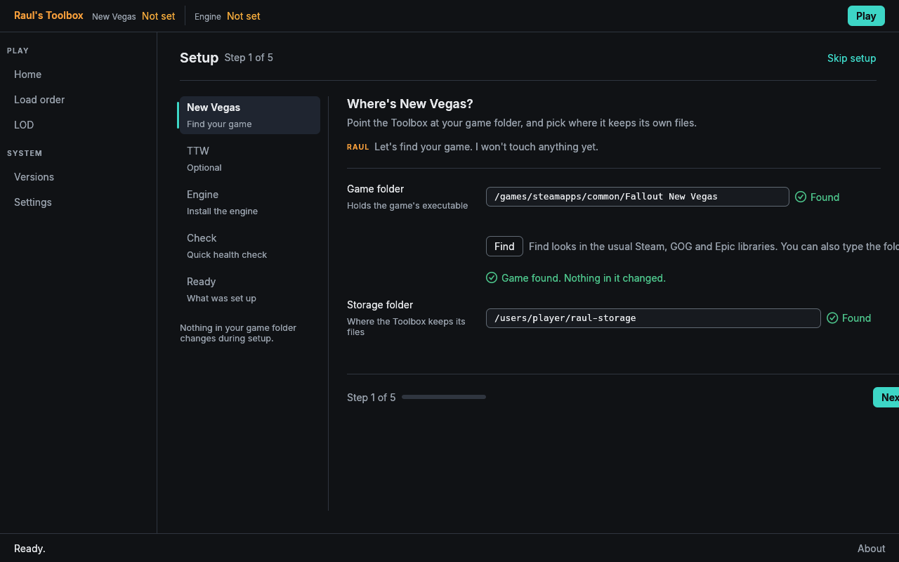
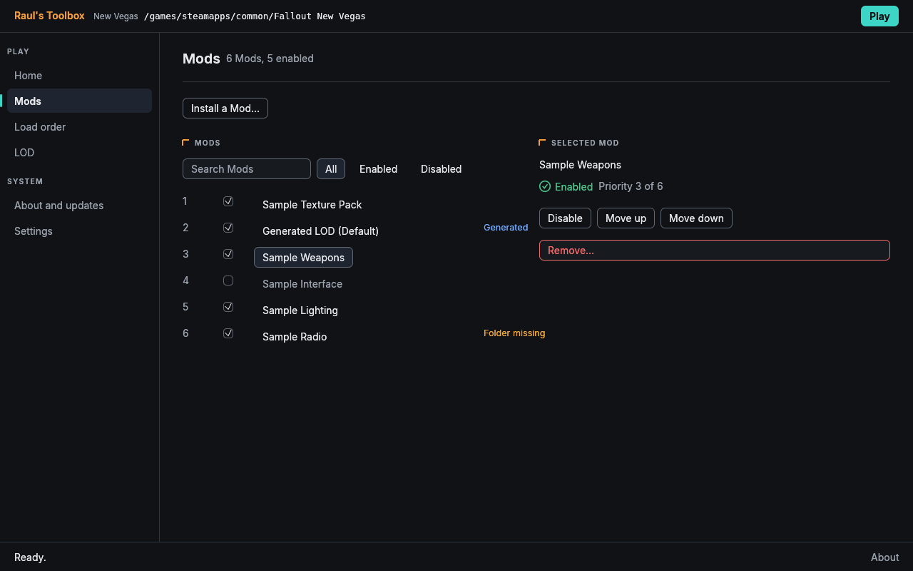
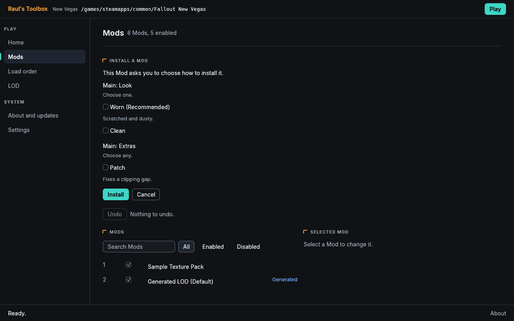
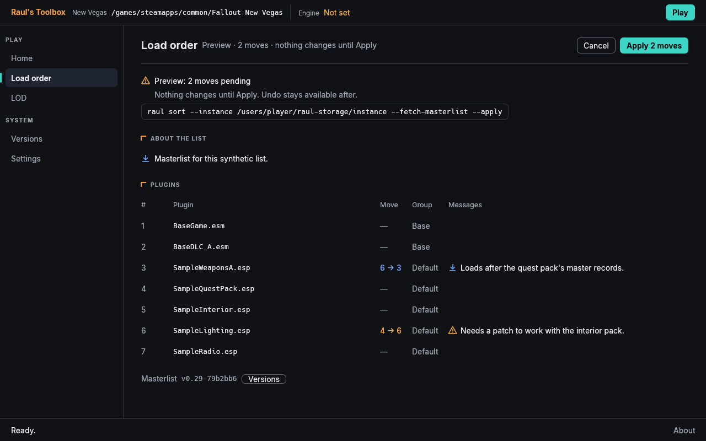
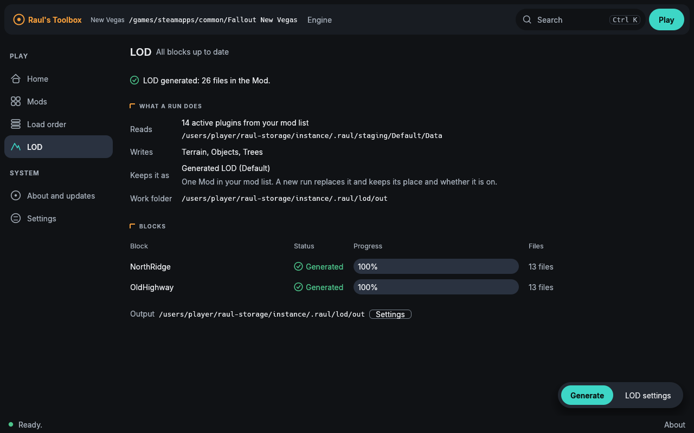
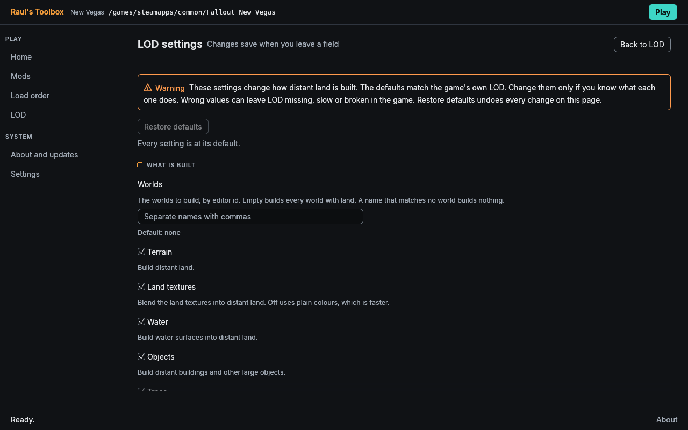
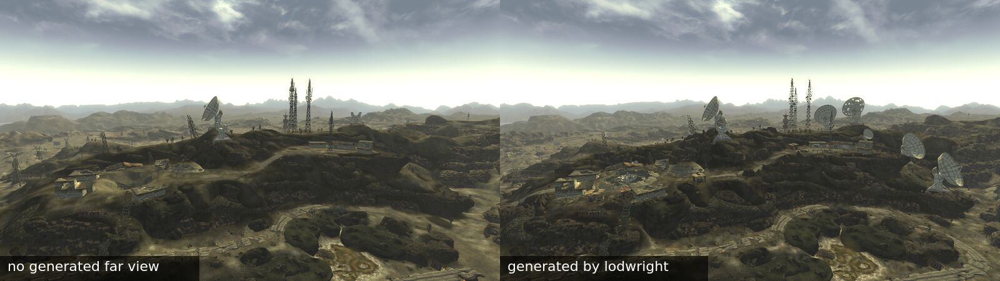
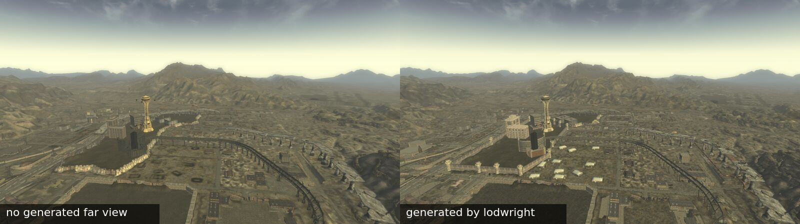
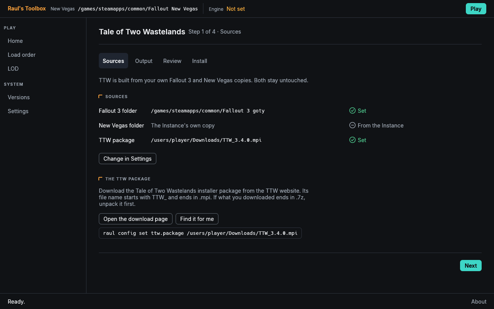
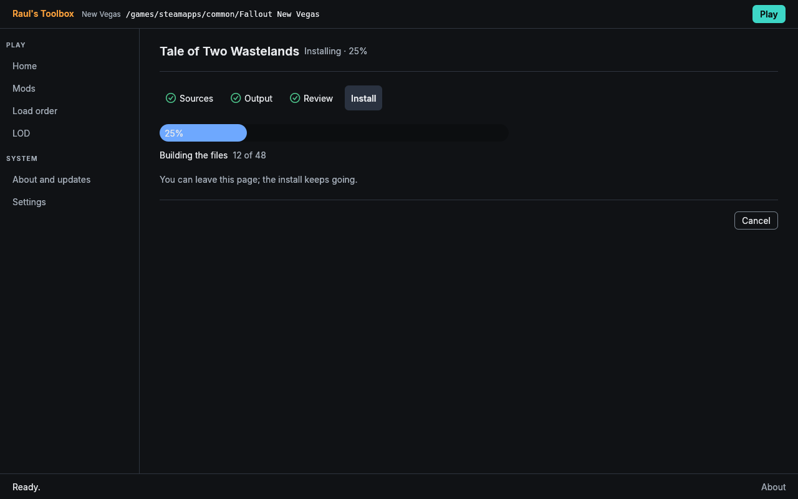

# A tour of raul

The [README](../README.md) is the short version. This page walks through raul's window, page by page.

The pictures below are raul's own pages, rendered by its test suite from made-up example data
(`crates/raul-gui/tests/snapshots`), so they always show the current window.

## Setup

The first start walks through five steps: find New Vegas (Steam, GOG and Epic libraries are searched), choose whether
you want Tale of Two Wastelands, make the Instance (raul's own folder for the game's mods, profiles and downloads), run a quick check, done.

## Mods

Install a mod from its archive; a mod with an installer (FOMOD) asks its questions in the window. Mods can be turned
on and off, moved up and down, and removed, and the last change can be undone. This page is
[nvmod-rs](https://github.com/JorisJonkers-dev/nvmod-rs) at work.

  
  

## Load order

Sort the plugins with the LOOT masterlist. raul shows every move and the masterlist's messages first, and changes
nothing until you press Apply. Sorting is [loot-rs](https://github.com/JorisJonkers-dev/loot-rs).

## LOD

Generate the distant land, objects and trees for exactly your load order. The result is one Mod in your mod list,
`Generated LOD (<profile>)`; a new run replaces it. The settings page changes what is built. The generator is
[lodwright-rs](https://github.com/JorisJonkers-dev/lodwright-rs).

  
  

Why it matters: with mods, the game's own far view no longer matches the world you walk through. On a 312-mod Tale
of Two Wastelands profile, a far view generated for that load order brings back the dishes on Black Mountain and the
casinos and buildings of the Strip (right):

  
  

## Tale of Two Wastelands

TTW is built from your own Fallout 3 and New Vegas copies and the installer package you download from the TTW site;
both games stay untouched. raul checks the sources, shows where the output goes and how much space it needs, installs,
and adds TTW to the Instance as one Mod. The installer is [ttwright-rs](https://github.com/JorisJonkers-dev/ttwright-rs).

  
  

## Play

**Play** starts the game on the nv-rs engine, which is built into raul. The engine's graphics presets and its F10
overlay are described in the [nv-rs README](https://github.com/JorisJonkers-dev/nv-rs#readme). Settings holds the game
folders, the TTW package and raul's storage folder; About and updates checks for a new release only when you ask, and
an update keeps the version before it so you can go back.

The same steps as commands are in [USAGE.md](USAGE.md).
