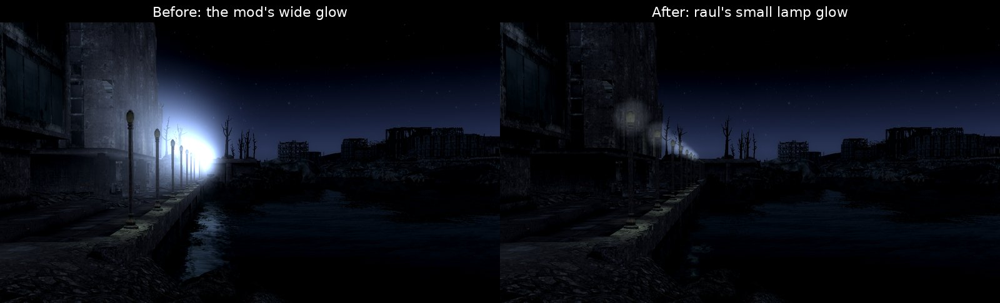

# Using raul from the command line

Every page of raul's window has a command, so raul also works in a terminal or a script:

```sh
raul detect                                   # find your game copies
raul init --base "<game folder>" --instance ~/raul/fnv
raul profile create --instance ~/raul/fnv
raul install <mod archive> --instance ~/raul/fnv
raul sort --instance ~/raul/fnv --fetch-masterlist --apply
raul ttw --instance ~/raul/fnv                 # Tale of Two Wastelands, if you want it
raul target nv-rs --instance ~/raul/fnv        # run on the engine built into raul; nothing to install
raul lod generate --instance ~/raul/fnv
raul addons list --instance ~/raul/fnv        # raul's add-ons for the mods you have, and where each stands
raul modlist plan beautiful --instance ~/raul/fnv   # what a Mod list has and lacks, and where to get it
raul run nv-rs --instance ~/raul/fnv
```

`raul help` lists the Toolbox's own commands, `raul nvmod-help` every nvmod command; add `--json` for scripts.

## Mod lists

A Mod list names Mods, where to get each one and the order they go in (ADR-0023). It holds no mod file. raul carries one,
**Beautiful** (Tale of Two Wastelands with the Wasteland Survival Guide set and the Beautiful 3c look); you can also point
raul at a list file of your own.

- `raul modlist list` names the lists raul carries; `raul modlist show beautiful` shows what one holds.
- `raul modlist plan beautiful --instance <dir>` says which of its Mods the Profile has, and for each one it lacks gives
  the Nexus page or other link, or says what to do by hand, in the order the Mods are installed in. Nothing is written
  and nothing is fetched; you download the files yourself. Installing a list comes in a later release.
- `raul modlist fetch beautiful --instance <dir>` prints the download page of each missing Mod; with `--open` the pages
  open in your browser (10 at a time, `--limit` changes that), through the system's opener.
- `raul modlist watch beautiful --instance <dir>` waits for the archives you download. It watches your download folder
  (the XDG one, `~/Downloads`) and the Instance's `downloads` folder, or the one `--downloads <dir>` names, and
  ignores partial files. Each new archive is recognised by its file name, then its size, then its md5 when the list
  has one; a file with the right name and the wrong size or md5 is refused. A match is copied into
  `<Instance>/downloads` (your download stays where it is). `--install` also installs it into the Profile with the
  existing nvmod install, under the list's name and placed last (list order comes with the installer for whole lists);
  a Mod whose installer asks questions stays staged. `--once` scans once and stops, `--scan-existing` also takes
  archives that were already there. It stops when everything it waits for is in, or on Ctrl+C.

## Nexus API key

`raul nexus key set` reads your Nexus Mods API key from standard input (never from an argument) and keeps it in the
operating system's keyring; `raul nexus key set --file` keeps it in a file only you can read instead, for a machine with
no keyring. `NEXUS_API_KEY` in the environment overrides both. `raul nexus key status [--json]` asks Nexus whose key it is
and whether the account is premium; `raul nexus key clear` removes it. The key is never written to `settings.toml`, shown
or logged. Only a premium account gets download links from Nexus; other files are downloaded by hand.

```sh
raul nexus key set < my-key.txt
raul nexus key status
```

## Add-ons

An add-on is a small Mod raul makes on your computer for a mod you installed, from numbers and from your own copy of
that mod's plugin; nothing of the game or the mod is downloaded or shipped. The first one is **Raul Small Lamp Glow**
for Street Lights TTW: it swaps the wide glow discs over the street lamps for a small, soft halo per bulb, and keeps
the lamps' light and beams.

<p align="center">
  
  <br><em>Street Lights TTW at night: one wide glow over the whole row (left), a small halo per bulb with raul's add-on (right).</em>
</p>

- `raul setup` adds the add-ons at its end, and `raul run` and `raul scene` check them before the game starts. Each
  change prints one line, such as `raul add-on Raul Small Lamp Glow: added the Mod ...`. A check that goes wrong
  prints a warning, and the game starts anyway.
- The add-on's Mod goes right above the mod it is for, and its plugin right after that mod's plugin. The Mods page
  tags it "Made by raul".
- Turn it off on the Mods page (or `raul mods disable "Raul Small Lamp Glow"`) and raul leaves it off; remove it and
  raul does not add it back. A Profile without the mod's plugin is never touched.
- `raul addons apply` does the same by hand; `--dry-run` only says what it would change.

The documents a command prints with `--json`, and its exit codes, are in [contracts/README.md](../contracts/README.md).
A tour of the window, page by page, is in [TOUR.md](TOUR.md).
