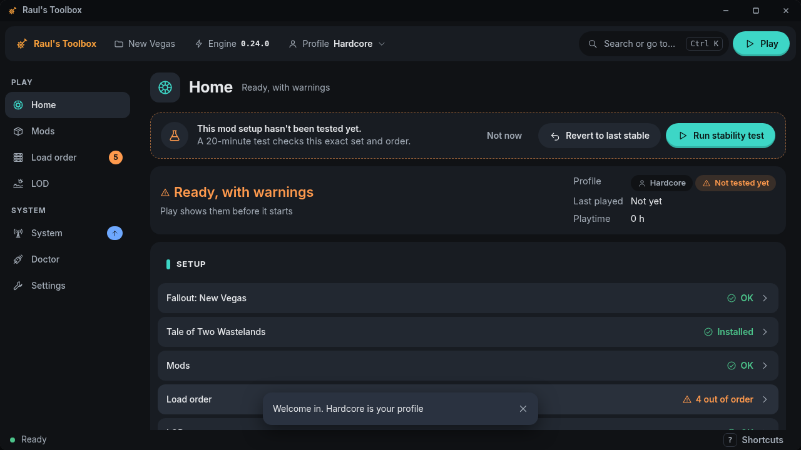

<!-- SPDX-License-Identifier: GPL-3.0-only -->
# Raul's Toolbox

*Modding New Vegas without the fRUSTration.*

Raul's tRusty Toolbox, or **raul**, is one app that sets up Fallout: New Vegas with your mods and starts the game.
It works on Linux, Windows and macOS, and it never changes your game folder.

You need your own copy of Fallout: New Vegas. raul ships no game files.

## What it does for you

1. Finds your game.
2. Adds Tale of Two Wastelands, if you want it. This is optional.
3. Installs your mods and keeps a list of which are on.
4. Sorts the load order, so mods that need each other load in the right order.
5. Builds the distant view, so far-away land matches your mods.
6. Starts the game on the built-in engine, nv-rs.

## Where to go next

- [Getting started](getting-started.md): download and install raul.
- [Using the Toolbox](using-the-toolbox.md): the pages of the window, one by one.
- [Features](features.md): what raul can do, in one list.
- [Plans and roadmap](roadmap.md): where the project is heading.
- [Components](components.md): the five parts raul is made of.
- [FAQ](faq.md): short answers.
- [Contributing](contributing.md): how changes are made.

You can also try the window in your browser. The [clickable demo](https://jorisjonkers-dev.github.io/rauls-trusty-toolbox/demo/) is the design of the app with made-up
data, and the [guided tour](https://jorisjonkers-dev.github.io/rauls-trusty-toolbox/tour/) walks you through it step by step.

## How far along it is

The first releases are out for Linux, Windows and macOS. They are early versions. Windows and macOS still need a full
test on real computers, and your computer may warn that the download comes from an unknown maker, because it is not
signed yet.

*The Home page as designed in the demo. The current release has a Home page too, with a similar check list.*
