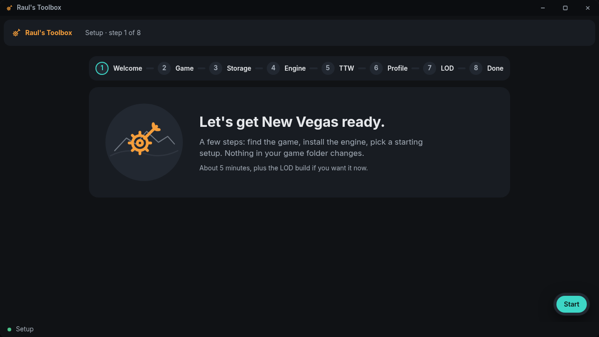
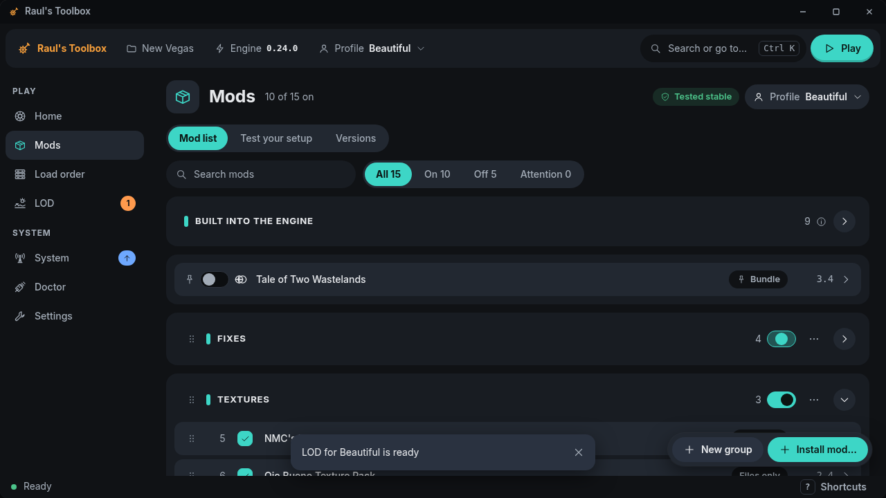

<!-- SPDX-License-Identifier: GPL-3.0-only -->
# Using the Toolbox

This page goes through the pages of raul's window. It keeps two things apart:

- **Current release:** what the latest release does today.
- **Planned design:** what the [clickable demo](https://jorisjonkers-dev.github.io/rauls-trusty-toolbox/demo/) shows. The demo is the design standard for the next
  versions of the window. Its data is made up and it does not touch a game.

Try the planned design yourself in the [guided tour](https://jorisjonkers-dev.github.io/rauls-trusty-toolbox/tour/).

## At a glance

| Page | Current release | Planned design |
| --- | --- | --- |
| Setup | Five steps | Eight steps |
| Home | Yes | Yes, with a profile switcher |
| Mods | Yes | Yes, with groups, test tab and versions |
| Load order | Yes | Yes, with missing master warnings |
| LOD | Yes | Yes, with a quality choice and fine-tuning |
| System | Engine and update page | Updates for all parts in one place |
| Doctor | Not yet | Yes |
| Settings | Yes | Yes |
| Profiles | Not yet | Yes |
| Test your setup | Not yet | Yes |

## Setup

**Current release.** Five steps: find New Vegas, choose whether you want Tale of Two Wastelands, make the folder for
your mods, run a quick check, done.

**Planned design.** Eight steps: Welcome, Game, Storage, Engine, TTW, Profile, LOD and Done. Each step shows what was
found, what went wrong (game not found, wrong folder, low space) and a busy state. If you close the window, setup
carries on where it stopped.

## Home

**Current release.** A check list for the game folder, storage, Tale of Two Wastelands, load order and distant view,
and a Play button. Play checks your setup first.

**Planned design.** One column: the check list, the active profile, your play time and when you last played. A badge
on the sidebar tells you when something needs doing. Play always rechecks the setup, and tells you what is wrong in
plain words.

## Mods

**Current release.** Install a mod from its archive. A mod with an installer asks its questions in the window. Turn
mods on and off, move them up and down, remove them, and undo the last change.

**Planned design.** Mods sit in groups you name. Drag a mod into another group, or move it with the keyboard. A banner
reminds you when this exact setup has not been tested. The page has three views: Mod list, Test your setup and
Versions.

### Test your setup (planned design)

Three tools on the Mods page:

- **Stability test:** loads 40 places and travels between them, about 20 minutes. If it passes, the setup is marked
  as tested stable.
- **Benchmark:** the frame rate, with a history over time.
- **Location pictures:** the same spot at the same time of day, side by side, before and after a change. Scroll to zoom
  and drag to look around.

A filtered log shows warnings and errors.

### Versions (planned design)

Every change to your mods, order or game settings makes a version. You can go back to an earlier one, or forward again.
The list stays.

## Load order

**Current release.** Sorts your plugins with the LOOT masterlist. raul shows every move and the masterlist's messages
first, and changes nothing until you press Apply.

**Planned design.** The same preview, plus a warning when a plugin needs a master that is not on. The warning also shows
on Home and in the sidebar.

## LOD

LOD is what you see in the distance. Mods change the world, but the game's own far view stays the old one.

**Current release.** Generates the distant land, objects and trees for exactly your load order. The result is one mod,
`Generated LOD (<profile>)`, and a new run replaces it. A settings page changes what is built.

**Planned design.** A quality choice (for example Balanced or High), a state that says when the LOD is out of date
because mods changed, and fine-tuning for texture size and distance.

## Profiles (planned design)

A profile is a whole setup: mods on, order, settings, LOD and tests. Installed mods and groups are shared, so you
install a mod once. Switch, duplicate, rename or delete a profile from the top bar.

## Tale of Two Wastelands

**Current release.** TTW is built from your own Fallout 3 and New Vegas copies and the installer file from the TTW site.
raul checks the sources, shows where the output goes and how much space it needs, installs, and adds TTW as one mod.

**Planned design.** The same four steps, started from the Mods page when TTW is shown as Not added.

## System (planned design)

Checks for updates when you open it. One Update button; every part that changes says it will be updated, with a list of
changes. Engine builds are listed here, and you can switch between them.

## Doctor (planned design)

One button runs every check: game folder, storage, engine, TTW, mods, load order, LOD and whether the setup was tested.
Each problem has a button that fixes it or takes you to the right page.

## Settings

Game folders, the TTW installer file, raul's storage folder and the look of the window (including a high contrast mode).
The planned design adds start-setup-again, reduced motion and larger text.

## Keyboard

The planned design has a search box on Ctrl+K that jumps to any page, and a list of shortcuts on the question mark key.
Enter confirms a dialog and Escape cancels it.

## The same from the command line

Every page also exists as a command. See [Using raul from the command line](../USAGE.md) and the longer
[tour of the current window](../TOUR.md).
